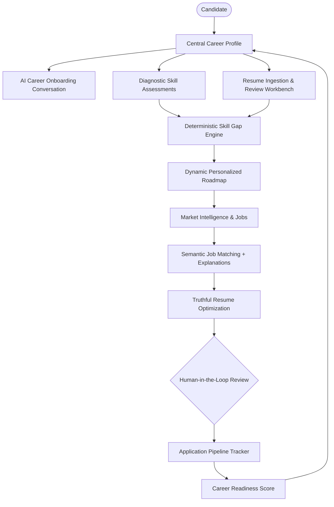

# CoachPath 🧭

> **Production-Grade AI-Powered Career Intelligence Platform**

CoachPath is an AI-powered personal career intelligence platform that systematically guides university students, recent graduates, and early-career technology professionals from their baseline skills to verifiable job readiness and employment.

---

## 💡 Product Overview

Early-career job seekers face an opaque and disjointed landscape: generic course syllabi fail to match employer hiring criteria, job portals produce endless noisy listings with no gap feedback, resume tools encourage superficial keyword stuffing or untruthful hallucinations, and application tracking is scattered across spreadsheets.

**CoachPath solves this by introducing a single, continuously updated career profile connected to an end-to-end intelligence loop:**
- **Evidence-Based Skills**: Rather than relying on self-reported claims, candidate skills are calibrated through objective diagnostic technical assessments and verified project artifacts.
- **Transparent Skill Gap Analysis**: Benchmarks candidate capabilities against empirical market requirements for target roles using deterministic mathematical scoring (0–100% Role Alignment and Evidence Coverage).
- **Dynamic Personalized Roadmaps**: Generates custom milestone learning plans targeted solely at verified gaps, automatically updating as new competencies are achieved.
- **Semantic Job Matching**: Multi-dimensional matching (skills, experience, and semantic vector similarity) accompanied by human-readable explanations of match fit.
- **Truthful Resume Optimization & Ingestion**: Securely extracts and reviews candidate documents with strict zero-fabrication standards, human-in-the-loop review, and visual conflict inspection.
- **Application Tracking & Readiness**: Integrated Kanban tracker tied directly to a composite Career Readiness Index (0–100%) providing clear next actions.

---

## 🔁 Core Product Loop



---

## 🏛️ Technology Stack

| Layer | Technology | Key Capabilities |
| :--- | :--- | :--- |
| **Frontend** | **Next.js 14 (App Router), React 18, TypeScript, Tailwind CSS** | Server-side rendering, responsive interface, radial SVG gauges, design system |
| **Backend** | **Python 3.13, FastAPI, SQLAlchemy 2.0 (Async), Alembic** | High-throughput async REST API, RFC 7807 problem details, lifespan seeders |
| **Relational Data** | **PostgreSQL 15 / 16** | ACID transactions, strict relational schemas, user career graph, snapshot history |
| **Vector Storage** | **pgvector** | Relational vector similarity search, unified backup/transactions |
| **Cache & Queue** | **Redis** | Fast token validation, rate-limiting, asynchronous task brokering |
| **AI Integration** | **Google Gemini (`gemini-3.5-flash-lite`), Instructor/Pydantic** | Zero-fabrication structured parsing, adaptive onboarding, quarantined prompts |
| **Testing** | **Pytest (Async), HTTPX, TypeScript (`tsc`), ESLint** | 217 automated backend integration tests, 100% type-checked frontend |

---

## 🎯 Target Benchmark Roles

CoachPath provides curated industry benchmark requirements across 7 canonical engineering and data paths:

1. **Backend Developer** (`backend-developer`): Python, SQL Databases, PostgreSQL, FastAPI, REST APIs, DSA, Redis, Docker, Git, Security, System Design.
2. **Frontend Developer** (`frontend-developer`): JavaScript, TypeScript, React, Next.js, HTML, CSS, Tailwind CSS, Web Development, REST APIs, Git.
3. **Full-Stack Developer** (`fullstack-developer`): JS/TS, React, Python, Web Development, SQL Databases, REST APIs, Docker, Git, DSA.
4. **Data Scientist** (`data-scientist`): Python, Machine Learning, SQL Databases, DSA, Deep Learning, PyTorch, Git.
5. **Machine Learning Engineer** (`machine-learning-engineer`): Python, Machine Learning, Deep Learning, PyTorch, Docker, REST APIs, DSA, SQL Databases, CI/CD.
6. **AI Engineer** (`ai-engineer`): AI & LLMs, Python, RAG, REST APIs, FastAPI, SQL Databases, Docker, Git, Security.
7. **DevOps & Cloud Engineer** (`devops-cloud-engineer`): Docker, Kubernetes, CI/CD, Linux, AWS, Terraform, Bash, Python, Git, Security.

---

## 🛡️ Responsible AI & Guiding Principles

1. **One Central Career Profile**: All intelligence derives from and feeds back into a single persistent profile.
2. **Strict Provenance Standards**: Self-reported skills or unapproved resume claims are tagged as `NOT_ASSESSED`. Only objective diagnostic assessments (score $\ge 70\%$) or verified project artifacts can award Level 3 (Proficient) or Level 4 (Mastered).
3. **Deterministic & Explainable Scoring**: Core skill gap alignment and evidence coverage execute mathematically without real-time LLM dependencies, eliminating scoring drift or hallucinated ratings.
4. **Human-in-the-Loop Review**:
   $$\text{CoachPath Prepares} \longrightarrow \text{User Reviews} \longrightarrow \text{User Approves} \longrightarrow \text{Transactional DB Merge}$$
   Resume extractions remain unapproved drafts until explicitly confirmed by the candidate.
5. **Anti-Hallucination & Truthfulness**:
   - 🚫 **Never** fabricate qualifications, degrees, employers, or skills.
   - 🚫 **Never** extrapolate beyond user-stated facts during onboarding.
6. **Privacy & Security First**: End-to-end data protection, multi-tenant ownership enforcement on every endpoint, Argon2id password hashing, and JWT refresh token rotation.

---

## 📦 Project Structure & Documentation

```
.
├── docs/                                          # Architecture & Audit Documentation
│   ├── product-requirements.md                    # Complete PRD: vision, personas, epics, NFRs
│   ├── system-architecture.md                     # Technical component topology & design
│   ├── database-schema.md                         # PostgreSQL, pgvector & Redis data models
│   ├── api-specification.md                       # REST API contracts & schemas
│   ├── authentication-architecture.md             # Argon2id, JWT rotation, and session security
│   ├── onboarding-architecture.md                 # AI Career Discovery & conversation engine (Phase 4A)
│   ├── phase-4-final-audit.md                     # End-to-end onboarding integration audit (Phase 4C)
│   ├── resume-parsing-architecture.md             # Resume extraction & Gemini structured parser (Phase 5A)
│   ├── resume-frontend-architecture.md            # Resume Review Workbench & approval workflow (Phase 5B)
│   ├── phase-5-final-audit.md                     # End-to-end resume integration audit (Phase 5C)
│   ├── diagnostic-assessments-architecture.md     # 270-question bank & scoring engine (Phase 6)
│   ├── diagnostic-assessments-final-report.md     # Assessments implementation report
│   ├── skill-gap-architecture.md                  # Deterministic Skill Gap Engine (Phase 6A)
│   ├── skill-gap-frontend-architecture.md         # Skill Gap Dashboard & UI specification (Phase 6B)
│   ├── phase-6b-final-report.md                   # Phase 6B final implementation report
│   ├── phase-6c-final-report.md                   # Phase 6C final integration audit & verification report
│   ├── roadmap-architecture.md                    # Personalized Learning Roadmap Engine (Phase 7A)
│   ├── phase-7a-final-report.md                   # Phase 7A final implementation report
│   ├── roadmap-frontend-architecture.md           # Learning Roadmap Dashboard & Frontend Architecture (Phase 7B)
│   ├── phase-7b-final-report.md                   # Phase 7B final implementation report
│   ├── phase-7-final-audit.md                     # Phase 7C final integration audit & verification report
│   ├── job-market-architecture.md                 # Job Market Intelligence & Ingestion Engine (Phase 8A)
│   ├── phase-8a-final-report.md                   # Phase 8A final implementation report
│   ├── job-discovery-frontend-architecture.md     # Job Discovery Frontend & Market Intelligence Specification (Phase 8B)
│   ├── phase-8b-final-report.md                   # Phase 8B final implementation report
│   ├── phase-8-final-audit.md                     # Phase 8C final integration audit & verification report
│   ├── job-matching-architecture.md               # Intelligent Job Matching Engine Architecture (Phase 9A)
│   ├── phase-9a-final-report.md                   # Phase 9A final implementation report
│   ├── job-matching-frontend-architecture.md      # Recommendations UI & Match Drawer Architecture (Phase 9B)
│   ├── phase-9b-final-report.md                   # Phase 9B final implementation report
│   ├── phase-9-final-audit.md                     # Phase 9C final integration audit & verification report
│   ├── phase-10a-resume-tailoring-backend.md      # Resume Tailoring & Optimization Architecture (Phase 10A)
│   ├── phase-10a-test-report.md                   # Phase 10A Test Execution Report
│   ├── deployment-readiness-audit.md              # Staging Deployment Architecture & Security Audit
│   └── deployment-staging-report.md               # Staging Deployment & Verification Runbook
├── backend/                                       # FastAPI / Python 3.13 Backend Workspace
│   ├── app/
│   │   ├── ai/                                    # LLM provider abstraction (Gemini, OpenAI, Anthropic, Mock)
│   │   ├── api/routes/                            # Auth, Profile, Onboarding, Resume, Assessments, Skills, Roles, Roadmap, Jobs
│   │   ├── core/                                  # Config, Security, Database session, RFC 7807 Exceptions
│   │   ├── db/seeds/                              # Question bank (270 questions), Canonical taxonomy (48 skills), Roles, Seed jobs
│   │   ├── models/                                # SQLAlchemy 2.0 async domain models (including Job, JobSource, JobSkill, JobIngestionRun, JobMatch)
│   │   ├── schemas/                               # Pydantic v2 validation contracts
│   │   └── services/                              # Engine implementations (Onboarding, Resume, Assessment, Skill Gap, Roadmap, Job Ingestion, Job Matching, Resume Tailoring)
│   ├── alembic/                                   # Async schema migrations (all tables to head)
│   └── tests/                                     # Comprehensive Pytest test suite (246 passing tests)
├── frontend/                                      # Next.js 14 App Router Frontend Workspace
│   ├── src/app/(public)/                          # Landing, Login, Signup, About, Features, Privacy
│   ├── src/app/(app)/                             # Protected routes: /dashboard, /onboarding, /resume, /assessments, /skills, /roadmap, /jobs, /jobs/[id]
│   ├── src/components/                            # UI Design System, Onboarding, Resume Workbench, Skill Gap, Roadmap, Jobs
│   ├── src/lib/                                   # Typed API clients (Auth, Profile, Onboarding, Resume, Skill Gap, Roadmap, JobClient)
│   └── src/types/                                 # Strict TypeScript domain interfaces
├── docker-compose.yml                             # Container orchestration for FastAPI & PostgreSQL (pgvector)
├── .env.example                                   # Configuration template for local & production
└── README.md                                      # Project overview and run guide
```

---

## ⚡ Step-by-Step Quickstart Guide

Follow these exact commands to run and test CoachPath locally from scratch.

### Step 1: Ensure PostgreSQL is Running

CoachPath uses PostgreSQL for data persistence. Start PostgreSQL locally via Homebrew or Docker:

```bash
# Using Homebrew (macOS)
brew services start postgresql@15

# OR using Docker Compose
docker compose up -d db
```

---

### Step 2: Terminal 1 — Start the Backend (FastAPI on Port 8000)

```bash
# 1. Navigate to the backend directory
cd /Users/anmolsharma/Desktop/Coach_Path/backend

# 2. Activate the Python virtual environment
source .venv/bin/activate

# 3. Apply all database migrations to head
alembic upgrade head

# 4. Start the FastAPI development server
uvicorn app.main:app --reload --host 0.0.0.0 --port 8000
```

> [!NOTE]
> On startup, the backend lifespan handler automatically seeds:
> - **Canonical Skills Taxonomy**: 48 standardized skills and 100+ alias mappings.
> - **7 Industry Target Roles**: 65 curated benchmark requirements.
> - **Diagnostic Skill Assessments**: 270 questions across 9 categories.
>
> Verify the backend is running:
> - **Swagger API Documentation**: [http://localhost:8000/docs](http://localhost:8000/docs)
> - **Health Endpoint**: [http://localhost:8000/api/v1/health](http://localhost:8000/api/v1/health)

---

### Step 3: Terminal 2 — Start the Frontend (Next.js on Port 3000)

```bash
# 1. Navigate to the frontend directory
cd /Users/anmolsharma/Desktop/Coach_Path/frontend

# 2. Start the development server
npm run dev
```

Open your browser at **[http://localhost:3000](http://localhost:3000)**.

---

### Step 4: Run the Automated Verification Suites

To verify all system contracts, run:

```bash
# Backend test suite (246 integration tests)
cd /Users/anmolsharma/Desktop/Coach_Path/backend
source .venv/bin/activate
pytest tests/ -v

# Frontend typecheck & production build (25/25 static pages)
cd /Users/anmolsharma/Desktop/Coach_Path/frontend
npx tsc --noEmit
npm run build
```

---

## 🚀 Development Phasing & Roadmap Status

CoachPath follows a phased engineering methodology:

- [x] **Phase 0: Product Definition & System Architecture** *(Completed — All 10 architecture records finalized)*
- [x] **Phase 1: Frontend Foundation, Design System & Product Shell** *(Completed — Next.js 14, Tailwind CSS, 12 Domain Shells)*
- [x] **Phase 2A: Backend Foundation & Infrastructure Setup** *(Completed — FastAPI, SQLAlchemy 2.0 Async, Alembic)*
- [x] **Phase 2B: Master PostgreSQL Data Layer Implementation** *(Completed — 37 SQLAlchemy models, Alembic migrations)*
- [x] **Phase 2C: Backend & Database Integration Audit** *(Completed — Foreign key cascades, schema verification)*
- [x] **Phase 3A: Authentication Backend** *(Completed — Argon2id password hashing, JWT rotation, session invalidation)*
- [x] **Phase 3B: Frontend Authentication Integration** *(Completed — Edge middleware, protected route gates, session provider)*
- [x] **Phase 3C: User Profile Graph & Career Goals** *(Completed — Education, Experience, Projects, Certifications, Career Goals)*
- [x] **Phase 4A: AI Career Onboarding Backend** *(Completed — Google Gemini LLM adapter, conversation orchestrator, prompt protection)*
- [x] **Phase 4B: AI Career Onboarding Frontend** *(Completed — Adaptive chat UI, progress indicators, profile confirmation)*
- [x] **Phase 4C: AI Onboarding End-to-End Audit** *(Completed — 17-step user journey, zero-mock verification)*
- [x] **Phase 5A: Resume Upload & Parsing Engine** *(Completed — PDF/DOCX text extraction, Gemini structured parser, draft isolation)*
- [x] **Phase 5B: Resume Review & Verification Workbench** *(Completed — Visual review interface, conflict indicators, explicit approval CTA)*
- [x] **Phase 5C: Resume Processing End-to-End Audit** *(Completed — Provenance validation, anti-hallucination labeling)*
- [x] **Phase 6: Diagnostic Skill Assessments Overhaul** *(Completed — 270 questions bank across 9 categories, 20-question randomized sessions, state resumption, pedagogical review)*
- [x] **Phase 6A: Skill Gap Analysis Engine (Backend)** *(Completed — Canonical taxonomy of 48 skills, 9 benchmark roles, 79 requirements, deterministic alignment and coverage scoring)*
- [x] **Phase 6B: Skill Gap Analysis Dashboard (Frontend)** *(Completed — Target role selector, radial SVG gauges, 4-level competency breakdown, prioritized gaps list, evidence drilldown modal, snapshot history)*
- [x] **Phase 6C: Skill Gap Analysis End-to-End Testing & Final Audit** *(Completed — 20-step journey verified, 152 automated tests passing, 100% audit pass verdict)*
- [x] **Phase 7A: Personalized Learning Roadmap Engine (Backend)** *(Completed — 4-phase sequential milestones, topological prerequisite DAG validation, scheduling feasibility calculation, task tracking, dynamic evidence adaptation, 162 automated tests passing)*
- [x] **Phase 7B: Learning Roadmap Frontend Dashboard & Milestone Tracking** *(Completed — Interactive phase accordions, DAG dependency lock enforcement, task status transitions, deliverable proof URL submission, feasibility schedule banner, dynamic assessment adaptation, 100% type-checked Next.js pages)*
- [x] **Phase 7C: Learning Roadmap End-to-End Integration Testing & Audit** *(Completed — 20-step lifecycle verified, multi-profile personalization, workload feasibility calculations, deliverable proof URL validation, 168 automated tests passing, 100% audit pass verdict)*
- [x] **Phase 8A: Job Market Intelligence and Permitted Job Ingestion Engine (Backend)** *(Completed — Provider adapters for Seed, Manual, Arbeitnow, and Mock; data normalization, canonical skill extraction, idempotent upserts, search & market intelligence APIs, 185 automated tests passing)*
- [x] **Phase 8B: Job Discovery Frontend and Market Intelligence Integration** *(Completed — Next.js 14 interactive search & filter UI, sorting, canonical skill chips, job detail modal & deep-link route, real-time market intelligence dashboard, candidate manual import modal, 189 automated tests passing)*
- [x] **Phase 8C: Job Market End-to-End Testing & Final Audit** *(Completed — Comprehensive 18-step discovery audit, provider failure resilience, SSRF protection, freshness lifecycle policies, 195 automated tests passing, 100% audit pass verdict)*
- [x] **Phase 9A: Intelligent Job Matching Engine (Backend)** *(Completed — Deterministic multi-factor scoring, required vs preferred skill weighting, evidence provenance calibration, evidence coverage & provisional flags, grounded explainability drawers, 211 automated tests passing)*
- [x] **Phase 9B: Recommendations UI & Match Drawer Integration (Frontend)** *(Completed — Dual-tab recommendations hub, MatchScoreBadge with 4 fit tiers, MatchEvidenceCoverage progress indicators, JobMatchCard recommendations list, JobMatchDrawer with 4 explainability tabs, embedded personalized fit analysis in JobDetailPage & JobDetailModal, on-demand recalculation sync, 217 automated tests passing)*
- [x] **Phase 9C: Job Matching End-to-End Integration Testing & Audit** *(Completed — Comprehensive 21-step candidate matching journey, 5-factor deterministic formula, evidence provenance weighting, explainability drawer, multi-tenant isolation, 225 automated tests passing, 100% audit pass verdict)*
- [x] **Phase 10A: Resume Tailoring & Optimization Engine (Backend)** *(Completed — Gemini-powered evidence-grounded tailoring, strict anti-hallucination reconciliation, original resume immutability, multi-version draft lifecycle & approval gate, keyword coverage & gap analysis, structured diff API, 239 automated tests passing)*
- [ ] **Phase 10B: Resume Tailoring Workbench & Diff Inspector (Frontend)**
- [ ] **Phase 10C: Resume Tailoring End-to-End Testing & Final Audit**
- [ ] **Phase 11: Application Pipeline Tracker**
- [ ] **Phase 12: Recruiter Discovery & High-Context Networking**
- [ ] **Phase 13: Role-Specific Interview Preparation Engine**
- [ ] **Phase 14: Composite Career Readiness Engine**
- [ ] **Phase 15: Settings, Privacy Controls & Data Deletion**
- [ ] **Phase 16: Production Observability, Security Hardening & Rate Limiting**
- [ ] **Phase 17: End-to-End System Integration Testing & Launch Readiness**

---

## 📄 License

Proprietary — All rights reserved.
