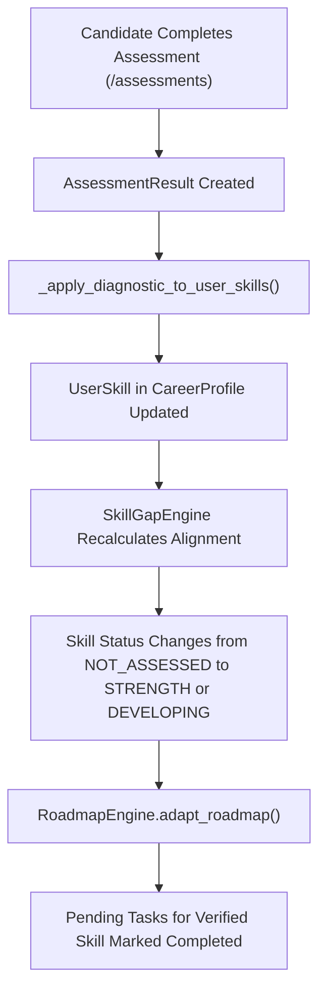

# CoachPath — Diagnostic Assessment Coverage & Question Bank Audit

> **Document Version**: 1.0.0  
> **Audit Date**: 2026-10-29  
> **Target Subsystem**: Group 3: Diagnostic Skill Assessments & Autograding Engine  
> **Status**: In-Depth Technical Verification Completed  

---

## 1. Executive Summary & Baseline Verification

A thorough audit of the question bank, assessment lifecycle APIs, difficulty distribution, autograding accuracy, and downstream skill calibration was performed across the codebase.

### Baseline Requirement vs. Actual Implementation

| Requirement Parameter | Specified Target | Actual Implementation | Audit Verdict |
| :--- | :--- | :--- | :---: |
| **Domain Categories** | 9 canonical engineering domains | Exactly 9 categories implemented | **MET** |
| **Questions per Category** | Minimum 30 distinct questions | Exactly 30 distinct questions per category | **MET** |
| **Total Question Bank Size** | Minimum 270 questions | Exactly 270 questions (seeded in database) | **MET** |
| **Questions per Attempt** | Exactly 20 questions | Exactly 20 questions drawn per session | **MET** |
| **Difficulty Distribution** | 7 Beginner, 7 Intermediate, 6 Advanced | Enforced: 7 Basic, 7 Intermediate, 6 Advanced | **MET** |
| **Answer Security** | Answer keys hidden during attempt | Answer index & explanation withheld until completion | **MET** |
| **Autograding Accuracy** | Deterministic server-side evaluation | Zero LLM hallucination; exact index comparison | **MET** |
| **Retake Diversity** | Meaningfully varied questions on retake | High overlap (~67% average repeat) due to small pool | **DEFICIENT** |
| **Option Randomization** | Varied option sequence | Static option ordering; options are never shuffled | **DEFICIENT** |

---

## 2. Category-by-Category Audit Matrix

Each of the 9 categories was inspected for question count, difficulty distribution, distinct topic coverage, code snippet presence, and formatting validity:

```
Category Breakdown: 9 Domains × 30 Questions = 270 Questions Total
Each Category: 10 Basic (33.3%) + 10 Intermediate (33.3%) + 10 Advanced (33.3%)
```

| Category ID | Display Title | Total Questions | Basic | Interm. | Adv. | Distinct Topics | Code Snippets | Passing Threshold |
| :--- | :--- | :---: | :---: | :---: | :---: | :---: | :---: | :---: |
| `python` | Python Programming Diagnostic | 30 | 10 | 10 | 10 | 30 | 16 | 70.0% |
| `javascript-typescript` | JavaScript & TypeScript Diagnostic | 30 | 10 | 10 | 10 | 30 | 18 | 70.0% |
| `java` | Java Programming Diagnostic | 30 | 10 | 10 | 10 | 30 | 14 | 70.0% |
| `c-cpp` | C & C++ Systems Programming Diagnostic | 30 | 10 | 10 | 10 | 30 | 19 | 70.0% |
| `sql-databases` | SQL & Relational Databases Diagnostic | 30 | 10 | 10 | 10 | 30 | 17 | 70.0% |
| `dsa` | Data Structures & Algorithms Diagnostic | 30 | 10 | 10 | 10 | 30 | 11 | 70.0% |
| `web-development` | Full-Stack Web Development Diagnostic | 30 | 10 | 10 | 10 | 30 | 12 | 70.0% |
| `machine-learning` | Machine Learning Diagnostic | 30 | 10 | 10 | 10 | 30 | 8 | 70.0% |
| `ai-llm` | Artificial Intelligence & LLMs Diagnostic | 30 | 10 | 10 | 10 | 30 | 9 | 70.0% |
| **TOTALS** | **9 Diagnostic Examinations** | **270** | **90** | **90** | **90** | **270** | **124** | **70.0%** |

---

## 3. Question Bank Integrity & Quality Verification

A dedicated verification script executed against all 270 questions confirmed the following technical invariants:
1. **Zero Text Duplicates**: Every `prompt_text` across all 9 seed files is unique.
2. **Zero Missing Explanations**: 100% (270/270) of questions include a detailed pedagogical explanation citing underlying engineering principles.
3. **Four Options Standard**: 100% (270/270) of questions have exactly 4 options.
4. **Valid Answer Keys**: 100% of `correct_option_index` values are integers between `0` and `3`.
5. **No Duplicate Option Strings**: Within every question, all 4 options are distinct strings.
6. **Code Snippet Formatting**: 124 questions include code blocks with language-specific syntax.

---

## 4. Attempt Selection & Retake Mechanics Audit

### 4.1 The Pigeonhole Repeat Overlap Flaw
In `backend/app/services/assessments.py`, line 236:
```python
# Seeded pseudo-random selection to ensure varied retakes while respecting difficulty
rng = random.Random(f"{user.id}_{assessment.id}_{int(datetime.now().timestamp() * 1000)}")
selected_basic = rng.sample(basic_pool, TARGET_BASIC_COUNT)        # 7 out of 10
selected_inter = rng.sample(inter_pool, TARGET_INTERMEDIATE_COUNT)  # 7 out of 10
selected_adv = rng.sample(adv_pool, TARGET_ADVANCED_COUNT)          # 6 out of 10
```

#### Mathematical Analysis of Retake Overlap:
- **Basic Tier**: Choosing 7 items from a pool of 10 means any two attempts will overlap by at least `7 + 7 - 10 = 4` questions (minimum 40% overlap; expected overlap $\approx 4.9$ questions).
- **Intermediate Tier**: Choosing 7 items from 10 means any two attempts will overlap by at least `4` questions (expected overlap $\approx 4.9$ questions).
- **Advanced Tier**: Choosing 6 items from 10 means any two attempts will overlap by at least `6 + 6 - 10 = 2` questions (expected overlap $\approx 3.6$ questions).

**Total Guaranteed Overlap**: Any candidate retaking an assessment is guaranteed to see at least **10 identical questions (50%)**, and on average will see **13.4 identical questions (67%)** from their previous attempt.

Furthermore, the selection algorithm is **stateless**: it does not check which questions the candidate previously answered correctly or incorrectly.

### 4.2 Static Option Ordering Flaw
In `backend/app/services/assessments.py`, line 788:
```python
public_questions.append(
    AttemptQuestionPublic(
        id=q.id,
        index=idx,
        prompt_text=q.prompt_text,
        code_snippet=q.code_snippet,
        options=q.options,  # <-- Raw seed order preserved
        difficulty=q.difficulty,
        topic=q.topic,
    )
)
```
The options array is sent to the client in the exact order stored in the database. A candidate who remembers that option "C" was correct on a previous attempt can simply select "C" again upon retake without re-evaluating the question.

### 4.3 Static Sequence Order
Questions are sequenced strictly in difficulty order: 7 Basic $\rightarrow$ 7 Intermediate $\rightarrow$ 6 Advanced. While pedagogically comfortable, questions are never interleaved by topic.

---

## 5. Security & Autograding Integrity

### 5.1 Answer Key Concealment
- During an active attempt (`in_progress`), `GET /assessments/attempts/{id}` returns `AttemptSessionResponse` containing `AttemptQuestionPublic`, which explicitly omits `correct_option_index` and `explanation`.
- Inspecting HTTP responses via browser DevTools cannot reveal the correct answer key.

### 5.2 Server-Side Grading
- Grading occurs exclusively in `AssessmentService.complete_attempt()` in backend Python code.
- Each answer is compared server-side against `AssessmentQuestion.correct_option_index`.
- Scoring formula: $\text{score} = \text{round}\left(\frac{\text{correct\_count}}{\text{total\_questions}} \times 100.0, 1\right)$.
- Passing status: $\text{passed} = (\text{score} \ge \text{passing\_threshold})$.

### 5.3 Attempt Ownership & Anti-Snooping
- `_enforce_ownership(attempt, user)` verifies `attempt.user_id == user.id`. Candidate B cannot view or submit answers to Candidate A's attempt (`403 Forbidden`).

---

## 6. Downstream Platform Integrations



1. **UserSkill Calibration**: When an assessment is completed, `_apply_diagnostic_to_user_skills()` sets:
   - `confidence_score = round(score / 100.0, 2)`
   - `proficiency_tier`: `mastered` ($\ge 85\%$), `proficient` ($\ge 70\%$), `demonstrated` ($\ge 50\%$), or `unverified` ($< 50\%$)
   - `is_verified`: `True` if score $\ge 70.0\%$
   - `primary_source`: `'assessment'`
2. **Skill-Gap Analysis**: When `SkillGapEngine` evaluates role requirements, verified skills provide full evidence weight, increasing both `role_alignment_score` and `evidence_coverage_score`.
3. **Roadmap Adaptation**: `RoadmapEngine.adapt_roadmap()` queries all passed attempts and automatically marks pending roadmap tasks matching the verified `skill_id` as `completed`.

---

## 7. Future Question Types & Scoring Engine Boundaries

The current autograding engine is optimized for single-select 4-option multiple-choice questions. Extending to advanced question types requires careful architectural boundaries:

| Proposed Question Type | Current Engine Support | Engine Modifications Required | Scoring Reliability |
| :--- | :---: | :--- | :---: |
| **Multiple-Select (Checkboxes)** | No | Change `selected_option_index` to array; partial credit logic. | High (deterministic) |
| **Code Tracing & Output Prediction** | **Yes** (via `code_snippet`) | None; already implemented across 124 questions. | High (deterministic) |
| **Live Code Execution / Sandboxed Pytest** | No | Requires sandboxed execution container (e.g. gVisor / Docker). | High (unit test based) |
| **SQL Schema Query Evaluation** | No | Requires ephemeral SQLite / PostgreSQL test harness. | High (result table matching) |
| **System Design / Architecture Free-Form** | No | Requires rubric-based LLM grading with human calibration. | Low (subjective / variance) |

> [!IMPORTANT]
> Rubric-based subjective LLM evaluations should **never** be mixed with deterministic diagnostic test scores without an explicit "Rubric Evaluated" label, preserving the zero-hallucination autograding guarantee.

---

## 8. Prioritized Remediation & Question Bank Roadmap

### Priority 1: High-Impact Engine Upgrades (Before Phase 10B/Assessments Overhaul)
1. **Dynamic Option Shuffling**: Seed a deterministic per-attempt option permutation so option positions vary across attempts.
2. **Anti-Repeat Retake Memory**: Modify `start_or_resume_attempt` to query previous attempts by the candidate and prioritize unasked questions from the bank.

### Priority 2: Question Bank Expansion (Phase 11)
1. **Double Pool Size**: Expand from 30 to 60 questions per category (20 basic, 20 intermediate, 20 advanced). Drawing 20 questions from a 60-question pool drops retake overlap from 67% to under 25%.
2. **Add Missing Specialized Tracks**: Add diagnostic categories for **DevOps/Kubernetes**, **Mobile Engineering (React Native/Flutter/iOS)**, and **Cloud Architecture (AWS/GCP)**.
