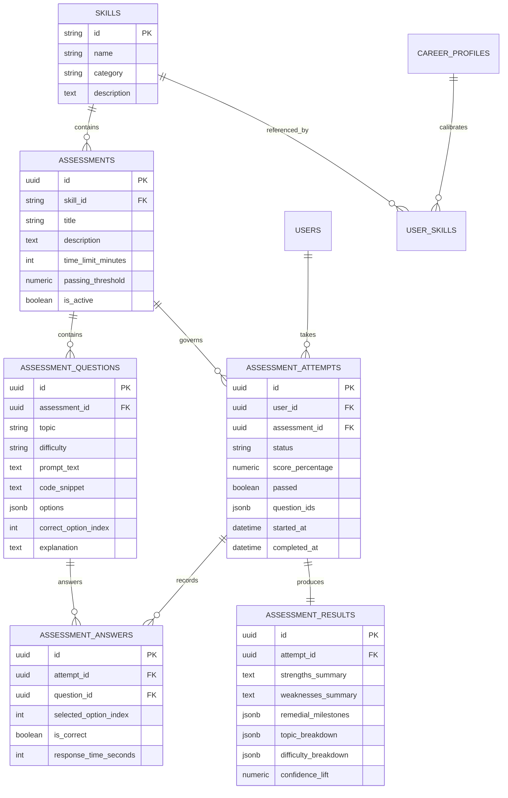

# CoachPath Diagnostic Skill Assessments Architecture

> **Document Version**: 1.0.0  
> **Status**: Completed & Production Ready  
> **Date**: October 22, 2026  
> **Author**: Engineering & AI Calibration Team  

---

## 1. Executive Overview

The **CoachPath Diagnostic Skill Assessments** system is a deterministic, server-side examination and skill-calibration platform. It replaces informal self-reported user claims and arbitrary single-question mockups with rigorous, multi-tiered technical examinations across **9 core engineering domains**.

The platform is designed around strict architectural guarantees:
- **No LLM Hallucination for Assessment Truth**: All diagnostic questions, answer choices, and rubrics are curated in a version-controlled, deterministic question bank with verified answer keys.
- **Server-Side Grading & Answer Protection**: Answer keys (`correct_option_index`) and pedagogical explanations are strictly sealed on the server during active test execution and only revealed post-completion.
- **20-Question Diagnostic Calibration**: Each diagnostic attempt dynamically selects exactly **20 questions** adhering to a calibrated difficulty distribution: **7 Basic**, **7 Intermediate**, and **6 Advanced** questions.
- **State Persistence & Resume Capabilities**: An attempt's selected question sequence and answers persist in PostgreSQL, surviving page refreshes, tab closures, and device switches.
- **Historical Retake Preservation**: Retakes generate fresh randomized attempts from the question bank while permanently recording historical attempts and scores for candidate career progression tracking.

---

## 2. Supported Assessment Categories

The assessment architecture provides full coverage across nine core technical domains:

| # | Category Identifier | Canonical Skill Name | Ontological Tier | Focus Areas & Syllabus |
|---|---|---|---|---|
| **A** | `python` | Python | `language` | Data structures, operators, loops, comprehensions, exceptions, file I/O, OOP, dunder protocols, context managers, generators, decorators, memory/GC, GIL, asyncio. |
| **B** | `javascript-typescript` | JavaScript & TypeScript | `language` | Variable scoping (TDZ), type coercion, closures, prototype chain, microtask event loop, DOM bubbling, TypeScript generics, conditional types, mapped types, `infer`, template literals. |
| **C** | `java` | Java | `language` | Primitive autoboxing, string immutability, access modifiers, OOP overriding, checked/unchecked exceptions, HashMap mechanics, Generics (PECS), JMM stack vs heap, GC generations, concurrency (`volatile`, `ConcurrentHashMap`), Virtual Threads. |
| **D** | `c-cpp` | C & C++ | `language` | Pointer arithmetic, dynamic memory (`malloc`/`free`), struct padding, dangling pointers, double pointers, C++ references, RAII, vtables/vptr, smart pointers (`unique_ptr`, `shared_ptr`), move semantics, SFINAE. |
| **E** | `sql-databases` | SQL & Relational Databases | `database` | Constraints, DDL/DML, three-valued logic, GROUP BY/HAVING, Joins, UNION ALL, CTEs (`WITH RECURSIVE`), window functions (`ROW_NUMBER`, `RANK`, `LEAD`/`LAG`), normalization (3NF/BCNF), B-Tree indexing, MVCC, isolation levels, write skew. |
| **F** | `dsa` | Data Structures & Algorithms | `concept` | Big-O analysis, dynamic arrays, linked lists, stacks, queues, binary search, BST traversals, Merge Sort, Quick Sort, Binary Heaps, Graph BFS/DFS, Two-pointer/Sliding Window, Dynamic Programming, DSU, Segment Trees, KMP. |
| **G** | `web-development` | Full-Stack Web Development | `architecture` | HTTP methods/status codes, CSS Box Model/Flexbox, HTML5 a11y, Web Storage, REST conventions, CORS preflight, CSRF mitigation, XSS prevention, SSR vs SSG vs SPA, ETag revalidation, WebSockets vs SSE, HTTP/3 QUIC, INP/LCP. |
| **H** | `machine-learning` | Machine Learning | `concept` | Supervised vs unsupervised learning, MSE vs MAE, data leakage prevention, overfitting/underfitting, categorical encoding, feature scaling, precision vs recall, decision trees, L1 vs L2 regularization, ROC-AUC, Bagging vs Boosting, PCA, K-Means++, AdamW. |
| **I** | `ai-llm` | AI & Large Language Models | `concept` | A* search, activation non-linearities, CNN strides, LSTM gates, subword tokenization (BPE), GPT decoder-only transformers, in-context learning, embeddings/cosine similarity, scaled dot-product attention, RoPE, LoRA, FlashAttention, KV caching, MoE, DPO, ReAct agents. |

---

## 3. Question Bank Architecture & Distribution

### 3.1 Distribution Guarantees

The question bank contains **270 distinct, expert-verified questions** partitioned across all 9 domains:

$$\text{Total Questions} = 9 \times 30 = 270$$

Each individual domain contains:
- $\ge 10$ **Basic** questions (foundational syntax, language primitives, core concepts)
- $\ge 10$ **Intermediate** questions (applied patterns, architectural mechanics, standard algorithms)
- $\ge 10$ **Advanced** questions (internals, memory safety, concurrency, compiler optimizations)

### 3.2 Question Data Structure

Every question in `assessment_questions` is structured as:

```json
{
  "id": "uuid-v5",
  "assessment_id": "uuid-v5",
  "topic": "Subtopic Classification",
  "difficulty": "basic | intermediate | advanced",
  "prompt_text": "Scenario description or question prompt",
  "code_snippet": "// Optional formatted code block or null",
  "options": [
    "Choice A",
    "Choice B",
    "Choice C",
    "Choice D"
  ],
  "correct_option_index": 0,
  "explanation": "In-depth pedagogical rationale explaining why the correct choice is sound and why other choices are flawed."
}
```

### 3.3 Stable Deterministic Identifiers

To guarantee repeatability, seed operations use deterministic UUIDv5 values derived from a canonical namespace (`coachpath.dev`):

$$\text{Assessment UUID} = \text{UUIDv5}(\text{NAMESPACE\_DNS}, \text{"coachpath.dev/assessment."} + \text{skill\_id})$$
$$\text{Question UUID} = \text{UUIDv5}(\text{NAMESPACE\_DNS}, \text{"coachpath.dev/assessment."} + \text{skill\_id} + \text{".question."} + \text{index})$$

---

## 4. Attempt Selection & Execution Strategy

### 4.1 Default Attempt Sizing (20 Questions)

When a candidate initiates an assessment attempt, the engine draws exactly **20 questions** from the domain's 30-question bank:
- **7 Basic Questions** (sampled without replacement from the 10 basic questions)
- **7 Intermediate Questions** (sampled without replacement from the 10 intermediate questions)
- **6 Advanced Questions** (sampled without replacement from the 10 advanced questions)

$$7 + 7 + 6 = 20 \text{ Questions}$$

### 4.2 Sequence Ordering & Progression

Selected questions are ordered in ascending difficulty:
1. Questions 1–7: **Basic Foundations**
2. Questions 8–14: **Intermediate Applications**
3. Questions 15–20: **Advanced Architecture & Mechanics**

The list of selected question UUIDs is persisted directly to the `assessment_attempts.question_ids` JSONB column.

### 4.3 Resume on Refresh

If a candidate reloads their browser, navigates away, or loses connectivity during an active test:
1. The frontend invokes `POST /api/v1/assessments/{category_id}/start`.
2. The server detects the existing `in_progress` record for that user and domain.
3. The server retrieves the stored `question_ids` in exact order, joins the candidate's recorded answers, and returns the session state without re-sampling or resetting progress.

---

## 5. Server-Side Scoring & Proficiency Framework

### 5.1 Deterministic Scoring Formula

Assessment scoring is strictly computed on the server:

$$\text{Score} = \left( \frac{\text{Correct Answers}}{\text{Total Attempt Questions}} \right) \times 100.0$$

Each correct answer contributes exactly 5.0% to the overall score for a 20-question test. Unanswered questions receive 0 points.

### 5.2 Proficiency Band Classifications

Calibrated scores map directly to market readiness bands:

| Score Range | Proficiency Classification | Interpretation |
|---|---|---|
| **85.0% – 100.0%** | **Strong** | Demonstrates deep conceptual mastery and architectural fluency; ready for senior and staff-level challenges. |
| **70.0% – 84.9%** | **Proficient** | Solid applied competence; clears industry passing benchmarks with minor conceptual gaps. |
| **50.0% – 69.9%** | **Developing** | Familiar with core syntax and concepts; requires targeted remediation in advanced mechanics. |
| **0.0% – 49.9%** | **Foundational** | Early-stage learner; requires comprehensive foundational curriculum before re-attempting. |

### 5.3 Topic-Level and Difficulty Breakdown

The scoring engine aggregates results along two distinct axes:
1. **Subtopic Aggregation**: Grouping questions by `topic` (e.g. `Memory Management`, `Indexing`, `Event Loop`), computing total questions, correct answers, and accuracy percentage.
2. **Difficulty Aggregation**: Calculating individual scores for `basic`, `intermediate`, and `advanced` tiers.

---

## 6. Database Schema & Relationships



---

## 7. API Specification

| Endpoint | Method | Auth | Request Body | Response Model | Description |
|---|---|---|---|---|---|
| `/api/v1/assessments` | `GET` | Required | None | `List[AssessmentCategoryListItem]` | Lists all 9 assessment categories with candidate status and best score. |
| `/api/v1/assessments/{category_id}` | `GET` | Required | None | `AssessmentDetailResponse` | Syllabus, question bank counts, and topic distributions for a domain. |
| `/api/v1/assessments/{category_id}/start` | `POST` | Required | `{}` | `AttemptSessionResponse` | Starts a 20-question attempt or resumes an active in-progress attempt. |
| `/api/v1/assessments/attempts/{id}` | `GET` | Required | None | `AttemptSessionResponse` | Returns active attempt questions and recorded selections. Answer key is hidden. |
| `/api/v1/assessments/attempts/{id}/answer` | `POST` | Required | `SubmitAnswerRequest` | `SubmitAnswerResponse` | Records or updates an option selection for a question. |
| `/api/v1/assessments/attempts/{id}/complete` | `POST` | Required | `{}` | `AssessmentResultResponse` | Finalizes attempt, executes grading, and reveals pedagogical explanations. |
| `/api/v1/assessments/attempts/{id}/result` | `GET` | Required | None | `AssessmentResultResponse` | Retrieves finalized result review for completed attempts. |
| `/api/v1/assessments/history` | `GET` | Required | None | `List[AttemptHistoryItem]` | Lists all historical attempts taken by the candidate. |

---

## 8. Security & Answer Key Protection

1. **Answer Masking During Execution**: The schema `AttemptQuestionPublic` returned during active sessions strictly omits `correct_option_index` and `explanation`.
2. **Access Isolation**: Every attempt endpoint enforces candidate ownership (`attempt.user_id == current_user.id`). Unauthorized cross-user requests receive `403 Forbidden`.
3. **Immutability Post-Completion**: Attempts marked `completed` reject further answer submissions (`409 Conflict`).
4. **No Client-Side Scoring**: Grading occurs exclusively within the database transaction in `AssessmentService.complete_attempt`.

---

## 9. Verification & Testing Strategy

- **Bank Integrity**: Automated test `test_question_bank_completeness` asserts that all 9 categories exist, each contains $\ge 30$ questions, each has $\ge 10$ basic, 10 intermediate, and 10 advanced questions, with valid 4-option lists and explanations.
- **Attempt Sizing**: Test `test_start_attempt_20_questions_distribution` verifies the exact 7/7/6 difficulty quota and confirms answer keys are masked.
- **Resume Idempotency**: Test `test_attempt_resumed_on_refresh` confirms that re-invoking start returns the identical attempt ID and question ordering.
- **Grading & Retakes**: Tests `test_submit_answer_and_complete_attempt` and `test_retake_preserves_history` verify scoring math, band categorization, and historical non-destructive retakes.
