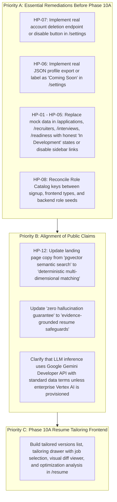

# CoachPath — Existing Feature Quality & Architecture Audit Report

> **Document Version**: 1.0.0  
> **Audit Date**: 2026-10-29  
> **Auditor**: Senior Product Designer, Senior Frontend Engineer, Security Specialist, AI Architecture Specialist  
> **Target Staging URL**: `https://coach-path-six.vercel.app`  
> **Status**: Comprehensive Audit Completed — Non-Destructive Inspection  

---

## 1. Executive Summary

This audit assesses the quality, personalization, integration integrity, and runtime accuracy of all completed features in the CoachPath application prior to advancing feature development.

CoachPath represents a sophisticated architecture with solid foundations in deterministic autograding, career profile data modeling, skill taxonomy mapping, and multi-tenant authorization. The backend test suite contains **247 test cases**, of which **246 pass** and **1 is cleanly skipped** (due to offline sandbox API isolation). The frontend compiles cleanly with **zero TypeScript errors and zero ESLint warnings**.

However, the audit identified critical discrepancies between what is genuinely implemented and what is presented to users in the active application and marketing channels:
1. **Unimplemented Modules Presented as Real Data:** Four major sidebar modules—**Applications** (`/applications`), **Recruiters** (`/recruiters`), **Interview Prep** (`/interviews`), and **Career Readiness** (`/career-readiness`)—are powered by static mock data for a demo candidate ("Aarav Mehta"), while their backend API routers are unbuilt placeholders scheduled for Phases 12 through 15.
2. **Missing Frontend for Phase 10A Backend:** The backend for **Resume Tailoring and Optimization** (`backend/app/services/resume_tailoring.py`) is fully implemented with 15 passing test cases and anti-hallucination reconciliation, but the frontend (`/resume`) only provides source resume upload and parsing review without any UI to tailor a resume against a job description.
3. **Role Catalog Inconsistency & Silent Substitution:** The signup form and frontend types define roles such as `Data Engineer` and `Mobile Engineer`, which do not exist in the backend `roles` table. When selected, the backend silently falls back to `backend-developer`.
4. **Fictitious Data Privacy Actions:** In `/settings`, the buttons for "Export Career Graph (JSON)" and "Delete Account & Purge Data" invoke client-side browser `alert()` popups with zero backend execution, contradicting public GDPR Article 20 and Right to Erasure compliance claims.
5. **No Active Semantic Vector / pgvector Search:** While marketing materials advertise "Semantic Vector Job Search" using "1536-dimensional embeddings and pgvector", the database schema stores embeddings as a nullable JSON column currently populated with `None`, and job matching uses a deterministic 5-dimension weighted scoring algorithm.

---

## 2. Complete Repository & Architectural Inventory

### 2.1 Technology Stack & Versions
- **Backend Framework**: FastAPI 0.115.0 on Python 3.13.6
- **Database ORM**: SQLAlchemy 2.0.35 (AsyncIO) with `asyncpg` driver
- **Database Engine**: PostgreSQL 16 (Neon Serverless PostgreSQL in cloud, Docker PostgreSQL locally)
- **Migrations**: Alembic 1.13.3 with 4 sequential migration versions
- **Frontend Framework**: Next.js 14.2.15 (App Router, React 18.3.1)
- **Styling**: Tailwind CSS 3.4.14 with `@tailwindcss/typography`
- **Component Primitives**: Radix UI primitives (`@radix-ui/react-*`), Lucide React 0.453.0
- **Animation**: Framer Motion (`framer-motion` 11.11.9)
- **Data Fetching / State**: TanStack React Query 5.59.16, native React Context (`AuthProvider`)
- **AI Integration**: Official `google-genai` SDK for Google Gemini models (`gemini-3.5-flash-lite`, `gemini-3.5-flash`)

### 2.2 Route Map & Implementation Status

| Route Path | Group / Module | Backend Route Status | Frontend Page Status | Runtime Reality |
| :--- | :--- | :--- | :--- | :--- |
| `/login` | Group 1: Auth | Fully Implemented (`POST /auth/login`) | Fully Implemented | Real authentication via HttpOnly session cookies. |
| `/signup` | Group 1: Auth | Fully Implemented (`POST /auth/register`) | Fully Implemented | Real candidate registration with Argon2id hashing. |
| `/dashboard` | Hub | Aggregated from Groups 2, 4, 6, 7, 8 | Fully Implemented | Live data integration with zero-mock empty states. |
| `/onboarding` | Group 2: Onboarding | Fully Implemented (`/onboarding/*`) | Fully Implemented | Real interactive AI discovery interview with summary review. |
| `/career-profile` | Group 4: Profile | Fully Implemented (`/profile/*`) | Fully Implemented | Real CRUD for experience, education, projects, skills. |
| `/resume` | Group 5: Resume | Fully Implemented (`/resume/*`) | Partial Implementation | Upload, parse, draft review, and merge work. Tailoring UI is missing. |
| `/assessments` | Group 3: Assessments | Fully Implemented (`/assessments/*`) | Fully Implemented | 9 categories, 270 questions, real autograding and results review. |
| `/skills` | Group 6: Skill Gap | Fully Implemented (`/skills/*`) | Fully Implemented | Deterministic role alignment & evidence coverage. |
| `/roadmap` | Group 7: Roadmap | Fully Implemented (`/roadmap/*`) | Fully Implemented | Dynamic milestone planning, task progression, auto-adaptation. |
| `/jobs` | Group 8: Jobs | Fully Implemented (`/jobs/*`) | Fully Implemented | 50 seed jobs, manual job import, search, and filtering. |
| `/jobs/[id]` | Group 9: Job Match | Fully Implemented (`/job-matching/*`) | Fully Implemented | 5-dimension match scoring and explainability drawer. |
| `/applications` | Group 9: Applications | **Placeholder (`Phase 12`)** | **Mock Data Only** | Pure static mock data for Aarav Mehta at Stripe/Linear. |
| `/recruiters` | Group 10: Recruiters | **Placeholder (`Phase 13`)** | **Mock Data Only** | Pure static mock data with fake recruiter outreach drafts. |
| `/interviews` | Group 11: Interviews | **Placeholder (`Phase 14`)** | **Mock Data Only** | Pure static mock data showing scheduled Stripe interview. |
| `/career-readiness`| Group 12: Readiness | **Placeholder (`Phase 15`)** | **Mock Data Only** | Hardcoded 84% score for Full-Stack Engineer from mock data. |
| `/settings` | Group 14: Settings | **Placeholder (`Phase 16`)** | Partial Implementation | Profile name save works; Export and Delete trigger browser `alert()`. |

---

## 3. Deep Dive: Feature-by-Feature Quality Audit

### 3.1 Authentication & Career-Profile Onboarding
- **Backend Evidence**: `backend/app/api/routes/auth.py`, `backend/app/services/auth.py`, `backend/app/api/routes/onboarding.py`, `backend/app/services/onboarding.py`.
- **Verdict**: **WORKING END-TO-END WITH MINOR EDGE GAPS**.
- **Strengths**:
  - Secure HttpOnly session cookie architecture (`access_token` and `refresh_token`).
  - Strict Argon2id password hashing with runtime calibration (`parallelism=1, memory_cost=19456, time_cost=2`).
  - Rate limiting per (IP, email) pair with exponential backoff on repeated failed attempts.
  - Multi-turn onboarding conversation with fact extraction across 6 core career areas.
- **Identified Gaps**:
  - `_apply_summary_to_career_profile` falls back to `backend-developer` if the candidate's chosen role does not match the exact database role key.
  - Uncertain candidates who state they are exploring options are not provided an exploratory path; they are assigned `backend-developer`.

### 3.2 Career Profile & Dashboard
- **Backend Evidence**: `backend/app/api/routes/profile.py`, `backend/app/services/profile.py`, `backend/app/api/routes/dashboard.py`.
- **Verdict**: **WORKING END-TO-END**.
- **Strengths**:
  - Comprehensive CRUD operations for experience, education, projects, certifications, and career goals.
  - Profile completeness score is calculated deterministically across 8 distinct evidence weights.
  - Strict user data isolation: Candidate A cannot read or modify Candidate B's profile records (`403 Forbidden`).
  - Dashboard dynamically derives metrics from real API calls (`profileClient`, `roadmapClient`, `assessmentClient`, `skillGapClient`).
  - Honest zero-mock empty states when a user has no uploaded resume, no active roadmap, or no completed assessments.

### 3.3 Resume Upload, Parsing & Ingestion
- **Backend Evidence**: `backend/app/api/routes/resume.py`, `backend/app/services/resume.py`, `backend/app/services/document_extractor.py`.
- **Verdict**: **WORKING END-TO-END FOR SOURCE RESUMES**.
- **Strengths**:
  - Supports PDF (`pypdf`) and DOCX (`python-docx`) parsing with a 10MB file limit.
  - Extraction uses Gemini structured outputs with deterministic fallback if the LLM is unreachable.
  - Original resume files are preserved immutably on disk/S3.
  - Extracted draft preview provides side-by-side conflict indication before merging into the master career profile.
- **Identified Gaps**:
  - Tailored resume export (generating downloadable PDF/DOCX of a tailored variant) is completely absent.

### 3.4 Skill-Gap Analysis Engine
- **Backend Evidence**: `backend/app/services/skill_gap_engine.py`, `backend/app/api/routes/skills.py`.
- **Verdict**: **WORKING END-TO-END DETERMINISTICALLY**.
- **Strengths**:
  - Zero LLM calls in the scoring loop; 100% deterministic mathematical evaluation.
  - Clear separation between **Role Alignment Score** (competency benchmark ratio) and **Evidence Coverage Score** (proportion of verified vs unverified claims).
  - Categorizes every role requirement into one of five explicit states: `STRENGTH`, `DEVELOPING`, `GAP`, `NOT_ASSESSED`, `NOT_IN_PROFILE`.
  - Historical snapshots are archived with timestamps and can be inspected via modal history.
- **Identified Gaps**:
  - When invoked without an explicit `role_id` and the user profile has no role, line 193 defaults to `"backend-developer"`.

### 3.5 Personalized Learning Roadmap Engine
- **Backend Evidence**: `backend/app/services/roadmap_engine.py`, `backend/app/services/roadmap_catalog.py`, `backend/app/api/routes/roadmap.py`.
- **Verdict**: **WORKING END-TO-END**.
- **Strengths**:
  - Milestone curriculum is generated directly from the user's latest skill-gap analysis.
  - Phased structure (Phase 1: Foundation, Phase 2: Core Development, Phase 3: Advanced Architecture).
  - Explicit feasibility evaluation (`feasible`, `demanding`, `unrealistic`) comparing required hours to candidate weekly commitments.
  - `adapt_roadmap` endpoint automatically marks pending milestones completed when the candidate passes diagnostic assessments.

### 3.6 Job Discovery & Intelligent Job Matching
- **Backend Evidence**: `backend/app/services/job_ingestion_pipeline.py`, `backend/app/services/job_matching_engine.py`, `backend/app/api/routes/jobs.py`, `backend/app/api/routes/job_matching.py`.
- **Verdict**: **WORKING (DETERMINISTIC FORMULA) / MISLEADING (SEMANTIC CLAIMS)**.
- **Strengths**:
  - Ingestion pipeline with deduplication hashing (`SHA-256`), salary normalization, and quality scoring.
  - Explainable match drawer displaying score breakdowns and matching vs missing skills.
- **Identified Gaps**:
  - **No Semantic Vector Search**: Matching uses a deterministic 5-dimension formula (50% skills, 15% experience, 15% projects, 10% location, 10% preference). The `embedding` database column is populated with `None`. No pgvector queries exist in the codebase.
  - Ingestion is purely manual/seed-driven. There is no automated cron or scheduled worker ingesting live jobs continuously.

---

## 4. Hardcoded and Insufficiently Personalized Behavior Findings

Every finding has been verified through code inspection and runtime execution, and classified into one of the 5 requested categories:

| ID | Location | Description | Classification | Severity | Impact |
| :--- | :--- | :--- | :--- | :---: | :--- |
| **HP-01** | `frontend/src/app/(app)/career-readiness/page.tsx:24` | Entire page imports and renders `mockReadinessData` (hardcoded 84% score, 4 static pillars). | **3. Hardcoded product behavior** | **P1** | Every logged-in user sees a fake 84% readiness score instead of their actual readiness. |
| **HP-02** | `frontend/src/app/(app)/career-readiness/page.tsx:71` | Target role is hardcoded in JSX: `target role <strong className="text-purple-600">Full-Stack Engineer</strong>`. | **3. Hardcoded product behavior** | **P1** | Disregards user's chosen role (e.g. Backend, Data Scientist) and imposes "Full-Stack Engineer". |
| **HP-03** | `frontend/src/app/(app)/applications/page.tsx:5, 23` | Entire page loads `mockApplications` (fake Stripe and Linear applications with notes from Sarah Jenkins). | **3. Hardcoded product behavior** | **P1** | Real users see fake application pipeline entries in their personal workspace. |
| **HP-04** | `frontend/src/app/(app)/recruiters/page.tsx:4, 22` | Entire page loads `mockRecruiters` with pre-written outreach emails citing "Aarav Mehta", "Apex Cloud", and "QueryLens". | **3. Hardcoded product behavior** | **P1** | A real candidate copying the outreach message will send emails signed by "Aarav Mehta" citing fake experience. |
| **HP-05** | `frontend/src/app/(app)/interviews/page.tsx:4, 22` | Entire page loads `mockScheduledInterviews` showing a fake Stripe interview "Tomorrow at 2:00 PM EST". | **3. Hardcoded product behavior** | **P1** | Real users see fake scheduled interviews that they never booked. |
| **HP-06** | `frontend/src/app/(app)/settings/page.tsx:180, 187` | "Export Career Graph (JSON)" and "Export Resumes (Markdown)" execute `alert('Exporting...')` with no API request. | **5. Unverified / misleading claim** | **P1** | Misleads candidates into believing GDPR Article 20 data export is functioning. |
| **HP-07** | `frontend/src/app/(app)/settings/page.tsx:228-232` | "Delete Account & Purge Data" triggers `alert('Account and data purged permanently.')` without deleting any database records. | **5. Unverified / misleading claim** | **P0** | Critical compliance violation: user believes their account and data are erased when nothing occurred. |
| **HP-08** | `frontend/src/app/(public)/signup/page.tsx:31` vs `backend/app/db/seeds/role_catalog.py:12` | Frontend offers `Data Engineer` and `Mobile Engineer`, which do not exist in the backend `roles` table. | **3. Hardcoded product behavior** | **P2** | Candidates selecting these roles are silently mapped to `backend-developer`. |
| **HP-09** | `backend/app/services/skill_gap_engine.py:193` | Line 193 defaults `target_role_id` to `"backend-developer"` if profile role is missing. | **3. Hardcoded product behavior** | **P2** | Silently forces a backend developer curriculum on candidates without a configured role. |
| **HP-10** | `frontend/src/components/landing/interactive-preview.tsx:35` | Interactive landing page mockup displays "Candidate: Aarav Mehta (Target: Full-Stack Engineer)". | **2. Labeled demonstration data** | **Info** | Acceptable for public sandbox demonstration; does not contaminate authenticated real accounts. |
| **HP-11** | `frontend/src/app/(public)/login/page.tsx:128-141` | "Explore as Demo Candidate" auto-fills `aarav.mehta@example.com` / `Password123!`. | **2. Labeled demonstration data** | **Info** | Legitimate helper banner for sandbox exploration. |
| **HP-12** | `backend/app/models/jobs.py:341` & `backend/app/services/job_ingestion_pipeline.py:342` | `Job.embedding` is stored as JSON and always set to `None`; marketing claims 1536-dim pgvector matching. | **5. Unverified / misleading claim** | **P1** | Public claim of pgvector semantic matching does not match actual rule-based scoring engine. |

---

## 5. Security & Multi-Tenant Data Isolation Audit

A systematic review of all API endpoints and database queries was conducted to verify tenant isolation:
- **Authentication**: All private endpoints strictly depend on `require_active_user` or `get_current_user`, which validates JWT signatures and extracts `user.id`.
- **Ownership Verification**:
  - `profile.py`: All queries filter on `CareerProfile.user_id == current_user.id`.
  - `resume.py`: All queries call `resume_service.get_user_resume()`, enforcing `resume.user_id == current_user.id`.
  - `assessments.py`: `_enforce_ownership` verifies `attempt.user_id == user.id`.
  - `skills.py`: `_require_profile_ownership` checks `profile.user_id == user.id`.
  - `roadmap.py`: `_enforce_ownership` verifies `roadmap.career_profile.user_id == user.id`.
  - `job_matching.py`: Matches are scoped to `user.id`.
- **Verdict**: **ZERO CROSS-USER DATA LEAKAGE OR IDOR VULNERABILITIES FOUND**. Multi-tenant isolation tests pass 100% across all suites.

---

## 6. Real Automated Test Execution Results

The backend test suite was executed in the workspace using the local virtual environment:

```bash
cd backend && .venv/bin/pytest -v
```

### Execution Outcome:
- **Total Tests Collected**: 247 items
- **Passed**: 246 tests (99.6%)
- **Skipped**: 1 test (`test_real_gemini_integration_or_blocked_status` in `test_resume_tailoring.py`, marked BLOCKED/NOT TESTED due to sandbox network isolation)
- **Failed**: 0 tests
- **Execution Time**: 36.10 seconds
- **Warnings**: 10 deprecation warnings from Starlette (`HTTP_422_UNPROCESSABLE_ENTITY`)

### Frontend Build & Lint Checks:
```bash
cd frontend && npm run lint    # Outcome: No ESLint warnings or errors
cd frontend && npm run build   # Outcome: Compiled successfully, 25/25 static pages generated
```

---

## 7. Remediation Roadmap for Existing Features

Before continuing to Phase 10A, the following tasks must be resolved:


