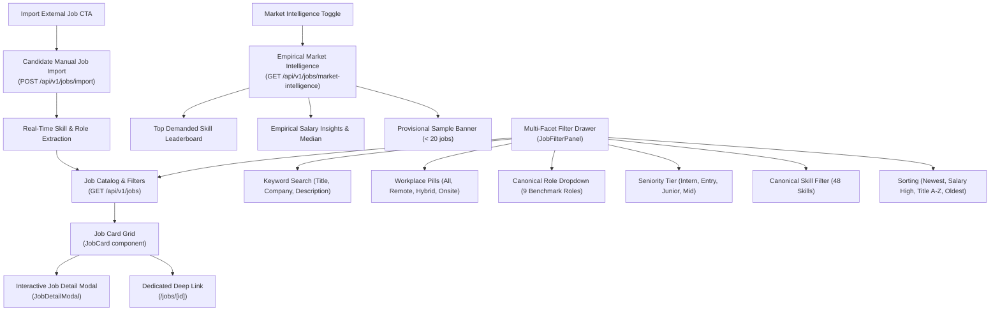
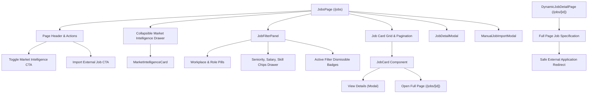

# CoachPath Job Discovery Frontend & Market Intelligence Architecture Specification

> **Document Version**: 1.0.0  
> **Lifecycle Phase**: Phase 8B — Job Discovery Frontend and Market Intelligence Integration  
> **Status**: Completed & Verified  
> **Target Audience**: Frontend Engineering, Backend Engineering, AI/Data Engineering, Product, Design  

---

## 1. Executive Summary

Phase 8B delivers CoachPath's interactive **Job Discovery and Market Intelligence Frontend** (`/jobs` and `/jobs/[id]`), directly connecting candidates to verified, empirical job market data collected and normalized by the Phase 8A backend pipeline.

Rather than presenting an unverified, generic list of mock job cards or fabricated match percentages, CoachPath provides a transparent, multi-faceted discovery experience anchored directly in the **Canonical Skill Taxonomy** (48 skills, 9 benchmark roles) and real database listings.



### Core Architecture Invariants

1. **Zero Fabricated Match Scores**: Phase 8B does not calculate, fabricate, or render artificial candidate match scores or fit percentages. Candidate-specific semantic job matching is scheduled for Phase 9.
2. **Transparent Freshness & Lineage**: Every job listing explicitly shows its origin source (`seed`, `manual`, `arbeitnow`) and its lifecycle freshness state (`active`, `needs_refresh`, `expired`, `closed`).
3. **Mandatory vs. Preferred Skill Distinction**: Skills extracted from job requirements clearly delineate mandatory technical prerequisites from preferred qualifications, maintaining strict alignment with Phase 6A/8A canonical taxonomy.
4. **Authentic Market Aggregates with Provisional Safeguards**: Market statistics (median salary, workplace flexibility distribution, skill demand) represent real empirical database samples. When sample size is developing ($< 20$ jobs), an explicit provisional warning banner is rendered.
5. **No Decorative or Fake Buttons**: Features not yet backed by backend tables or business logic (e.g. "Save Job", which belongs to the Phase 10 Application Pipeline Tracker) are intentionally omitted rather than displayed as dead or mock UI controls.
6. **Defensive Error & Empty State Handling**: Four distinct states are handled distinctly:
   - Initial empty database catalog
   - Search query yielding no matching results
   - External provider ingestion not configured
   - Server or network request failure with retry CTA.

---

## 2. Information Architecture & Component Hierarchy

The job discovery interface is located at `frontend/src/app/(app)/jobs/page.tsx` with dynamic detail pages at `frontend/src/app/(app)/jobs/[id]/page.tsx`. The implementation comprises high-cohesion, modular components under `frontend/src/components/jobs/`:



### Component Breakdown

| Component | File Path | Primary Responsibilities |
| :--- | :--- | :--- |
| **`JobsPage`** | `src/app/(app)/jobs/page.tsx` | Main page controller orchestrating catalog search, query debounce, pagination, stale response cancellation, filter state, and modal open states. |
| **`DynamicJobDetailPage`** | `src/app/(app)/jobs/[id]/page.tsx` | Deep-linkable standalone job view rendering comprehensive job details, required/preferred qualifications, canonical skills, and source provenance. |
| **`JobCard`** | `src/components/jobs/job-card.tsx` | Clean job summary card with role, company, location, workplace pill, honest salary, posted date, top required skills, source badge, and detail CTA. |
| **`JobDetailModal`** | `src/components/jobs/job-detail-modal.tsx` | Deep slide-over modal containing full role description, responsibilities list, mandatory vs preferred qualification breakdown, canonical skill badges with extraction source, and safe external apply link advisory. |
| **`JobFilterPanel`** | `src/components/jobs/job-filter-panel.tsx` | Responsive search and filtering panel with text keyword input, canonical role selector, workplace type pills, collapsible advanced filters drawer (experience tier, min salary, canonical skill tags), active filter badges, and reset CTA. |
| **`MarketIntelligenceCard`** | `src/components/jobs/market-intelligence-card.tsx` | Empirical market overview showing total active positions, median salary, workplace distribution, top 5 demanded skills with proportional bars, and provisional indicator. |
| **`ManualJobImportModal`** | `src/components/jobs/manual-job-import-modal.tsx` | Interactive modal allowing candidates to paste external job postings and immediately trigger backend extraction and catalog ingestion. |

---

## 3. Data Flow & API Client Layer

All API operations communicate with the backend through `frontend/src/lib/job-client.ts` using the shared authenticated `apiClient`:

```typescript
export class JobClient {
  // GET /api/v1/jobs?role_id=...&remote_type=...&page=...&sort_by=...
  public async searchJobs(query?: JobSearchQuery): Promise<JobSearchResponse>;

  // GET /api/v1/jobs/{id}
  public async getJobById(jobId: string): Promise<JobOpportunity>;

  // GET /api/v1/jobs/market-intelligence?role_id=...
  public async getMarketIntelligence(roleId?: string): Promise<MarketIntelligenceData>;

  // POST /api/v1/jobs/import
  public async importJob(payload: ManualJobImportPayload): Promise<JobOpportunity>;
}
```

### Stale Response Race Condition Safeguard

When rapid filter modifications or pagination clicks occur, asynchronous HTTP responses could arrive out-of-order. `JobsPage` implements a monotonic request sequence counter (`currentReqId`) that discards superseded responses, ensuring the UI always reflects the user's latest query parameters.

---

## 4. Backend Search API Extensions

To support the rich filtering and ordering requirements of the Phase 8B frontend, `backend/app/api/routes/jobs.py` was extended with:

1. **`employment_type` Filter**: Allows candidates to narrow listings by full-time, part-time, contract, or internship.
2. **`skill_id` Filter**: Direct relational join on `job_skills` table filtering by canonical skill identifier (e.g. `python`, `fastapi`, `react`).
3. **`sort_by` Query Parameter**:
   - `newest` (Default): Orders by `posted_at DESC, created_at DESC`.
   - `salary_high`: Orders by `max_salary DESC NULLS LAST, min_salary DESC NULLS LAST`.
   - `title_asc`: Orders alphabetically by `title ASC`.
   - `oldest`: Orders by `posted_at ASC, created_at ASC`.

---

## 5. Security & Provenance Safeguards

1. **Sanitized External URLs**: All external application URLs (`application_url` and `source_url`) are strictly validated against `http://` or `https://` protocols, rendered with `rel="noopener noreferrer" target="_blank"`, and accompanied by a security notice advising candidates they are navigating to an external third-party domain.
2. **Anti-Hallucination & Provenance Clarity**: Skills tagged on jobs include `is_mandatory` and the original `source_phrase` from the raw job description, enabling candidates to verify why a skill was extracted.
3. **Multi-Tenant Protection**: Candidate manual imports link to the authenticated candidate's user session while maintaining public catalog query accessibility across active benchmark opportunities.
