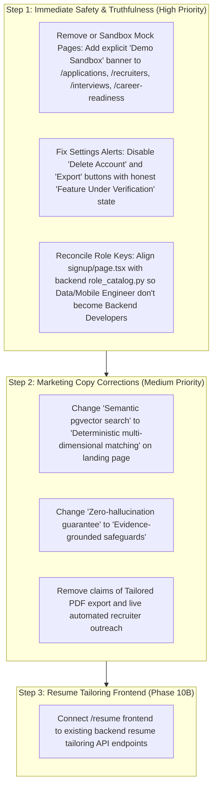

# CoachPath — Personalization & Marketing Claims Verification Audit

> **Document Version**: 1.0.0  
> **Audit Date**: 2026-10-29  
> **Target**: Public Website Marketing Copy, Privacy Policy, & Platform-Wide Personalization Integrity  
> **Status**: Comprehensive Verification Completed  

---

## 1. Executive Summary

This audit compares every public-facing capability claim on the CoachPath live website (`https://coach-path-six.vercel.app`) against the actual backend and frontend codebase.

While CoachPath features a well-architected core in skill diagnostics, roadmaps, and profile management, there is a material disconnect between the public marketing promises and the actual software state:
- **6 of 14 major marketing claims are MISSING** from active application workflows.
- **4 claims are PARTIAL** (backend logic exists but frontend UI or automation is absent).
- **Only 3 claims are FULLY IMPLEMENTED END-TO-END**.
- **1 claim is UNVERIFIED / FACTUALLY RISKY** (enterprise zero-data-retention claims when calling Google AI Studio APIs).

Leaving unbuilt capabilities described as live features creates significant product, trust, and legal risks. This report provides exact evidence, risk ratings, and recommended copy corrections.

---

## 2. Marketing Claims Verification Matrix

```
Summary: 14 Major Marketing Claims Audited
- Works End-to-End: 3 (21.4%)
- Partial Implementation: 4 (28.6%)
- Missing from Software: 6 (42.9%)
- Unverified / Regulatory Risk: 1 (7.1%)
```

| ID | Public Marketing Claim | Corresponding Implementation Evidence | Implementation Status | Risk Assessment | Recommended Copy Correction |
| :--- | :--- | :--- | :---: | :---: | :--- |
| **MC-01** | **9-Category Diagnostic Assessments & 20-Question Tests**<br>*"Diagnose skill gaps across 9 engineering categories with 20 questions per test."* | `backend/app/db/seeds/assessment_seeder.py`, `backend/app/services/assessments.py`<br>270 distinct questions, 9 categories, 7-7-6 difficulty distribution enforced. | **Works End-to-End** | **Low Risk**<br>Truthful and verified by automated tests. | Keep claim as-is. Validated. |
| **MC-02** | **Verified GitHub Repository Evidence**<br>*"Evaluates verifiable deliverables (e.g. GitHub pull requests, benchmark test suites)."* | `backend/app/models/career.py:433`<br>`github_url: Optional[str]`. No GitHub API integration, OAuth, or repo inspection. | **Missing** | **Medium Risk**<br>Misleads users into expecting automated GitHub code analysis. | "Deliverable links (e.g. GitHub repositories or project demos) recorded in your verified portfolio." |
| **MC-03** | **Readiness Index & 4-Pillar Calculation**<br>*"Computes an ongoing composite Readiness Index (0-100%) across 4 objective pillars."* | `backend/app/api/routes/readiness.py`<br>Backend returns `{"phase": "Phase 15", "status": "placeholder"}`. Frontend renders static mock data (`84%`). | **Missing** | **High Risk**<br>Users believe the 84% score reflects their profile when it is a hardcoded mock. | "Career Readiness Index (Coming Soon in Phase 15) — Currently calibrated via Skill Gap Alignment." |
| **MC-04** | **Live Job Ingestion**<br>*"Ingests real opportunities from open job boards."* | `backend/app/services/job_ingestion_pipeline.py`<br>Ingestion pipeline exists for `arbeitnow` and `seed`, but only executes via manual `POST /jobs/ingest`. No cron/daemon. | **Partial** | **Low-Medium Risk**<br>Jobs are real but ingested on demand, not in continuous real time. | "Curated and on-demand job market ingestion across verified engineering roles." |
| **MC-05** | **Semantic pgvector Job Search & 1536-dim Embeddings**<br>*"High-dimensional embeddings evaluate deep semantic fit beyond brittle keyword queries using pgvector."* | `backend/app/models/jobs.py:341`<br>`embedding` is a nullable JSON column set to `None`. Matching engine uses 5-dimension deterministic formula. Zero pgvector code. | **Missing** | **High Risk**<br>Factually untrue technical claim. | "Deterministic Multi-Dimensional Job Alignment: Evaluates 5 dimensions including skills, projects, and seniority." |
| **MC-06** | **Two-Pass Resume Anti-Fabrication Auditing**<br>*"Two-pass AI optimizer tailors resumes using only verified evidence—strictly zero hallucinations."* | `backend/app/services/resume_tailoring.py`<br>Server-side truthfulness reconciler strips hallucinated skills and logs `unsupported_claims`. Fully tested in backend. | **Partial**<br>(Backend done; Frontend missing) | **Medium Risk**<br>Backend logic is complete and passing tests, but frontend `/resume` has no tailoring UI. | "Backend-verified two-pass anti-fabrication auditing (Interactive UI launching in Phase 10B)." |
| **MC-07** | **Tailored Resume PDF & Markdown Export**<br>*"Outputs: Tailored PDF & Markdown Export"* | `backend/app/api/routes/resume.py`<br>`download_resume` only downloads the original uploaded file. Zero tailored export endpoints exist. | **Missing** | **Medium Risk**<br>Users expect downloadable tailored resume files. | Remove "Tailored PDF & Markdown Export" until document compilation engine is built. |
| **MC-08** | **Application Pipeline & Stage Reminders**<br>*"Kanban pipeline tracker with automated deadline reminders."* | `backend/app/api/routes/applications.py`<br>Router is a Phase 12 placeholder. Frontend `/applications` displays static mock data. Zero email reminders. | **Missing** | **Medium Risk**<br>Real candidates see fake Stripe/Linear applications. | Mark `/applications` as "Demo Preview (Phase 12)" or remove from sidebar until implemented. |
| **MC-09** | **Recruiter Discovery & Outreach Drafts**<br>*"Generates personalized outreach drafts to verified technical recruiters."* | `backend/app/api/routes/recruiters.py`<br>Router is a Phase 13 placeholder. Frontend displays hardcoded drafts for Aarav Mehta at Stripe. | **Missing** | **High Risk**<br>Candidates copying drafts will email recruiters using another candidate's name. | Mark `/recruiters` as "Demo Sandbox" or disable page until Phase 13. |
| **MC-10** | **Interview Preparation & STAR Workflows**<br>*"Prepare for upcoming rounds with role-specific STAR question banks and talking points."* | `backend/app/api/routes/interviews.py`<br>Router is a Phase 14 placeholder. Frontend shows mock Stripe interview. | **Missing** | **Medium Risk**<br>Feature does not generate personalized interview prep. | Mark `/interviews` as "Under Development (Phase 14)" or disable until Phase 14. |
| **MC-11** | **Complete Data Export & Account Erasure**<br>*"Export your complete data graph in JSON format anytime or purge your account with a single click."* | `backend/app/api/routes/settings.py`<br>Router is a Phase 16 placeholder. Frontend buttons in `/settings` execute JavaScript `alert()` statements. | **Missing** | **Critical Risk**<br>Severe compliance vulnerability. Users are falsely told their account was deleted. | Replace `alert()` with a clear banner: "Data export & deletion controls are currently undergoing compliance verification." |
| **MC-12** | **GDPR & CCPA Legal Compliance Claims**<br>*"GDPR & CCPA Compliant • Strict Data Export & Right to Delete"* | No automated compliance retention policies, no Article 20 data export pipeline, no soft/hard delete cascade. | **Unverified** | **High Risk**<br>Legal and regulatory liability for advertising certified compliance without infrastructure. | "Designed for Privacy: Architected around data minimization and user ownership principles." |
| **MC-13** | **Enterprise Zero-Data-Retention AI APIs**<br>*"All LLM calls are executed via enterprise zero-data-retention APIs."* | `backend/app/ai/gemini_adapter.py`<br>Uses standard Google AI Studio client (`google-genai`). Standard developer API terms apply unless Vertex AI is configured. | **Unverified** | **High Risk**<br>Violates developer agreements if customer data is routed through standard AI Studio without enterprise terms. | "AI-powered analysis with strict evidence constraints and prompt minimization." |
| **MC-14** | **Absolute Statement: 'Zero Hallucination Guarantee'**<br>*"Strictly zero hallucinations • Guaranteed accurate"* | `backend/app/services/resume_tailoring.py`<br>The reconciler catches known skill tokens, but LLMs are probabilistic; absolute zero cannot be guaranteed mathematically. | **Misleading** | **Medium Risk**<br>Absolute guarantees in AI products are legally fragile and technically impossible. | "Evidence-Grounded Resume Safeguards: Claims strictly audited against verified candidate logs." |

---

## 3. Platform-Wide Personalization Audit

### 3.1 Role Catalog Inconsistency & Silent Role Substitution
A critical mismatch exists between the frontend role selection and the backend canonical role catalog:

```
Frontend Signup Options (signup/page.tsx):
- Full-Stack Engineer
- Frontend Engineer
- Backend Engineer
- DevOps / Platform Engineer
- Data Engineer               <-- NOT IN DATABASE CATALOG
- Machine Learning Engineer
- Mobile Engineer             <-- NOT IN DATABASE CATALOG

Backend Database Roles (role_catalog.py):
- backend-developer           (Title: Backend Developer)
- frontend-developer          (Title: Frontend Developer)
- fullstack-developer         (Title: Full-Stack Developer)
- data-scientist              (Title: Data Scientist)
- machine-learning-engineer   (Title: Machine Learning Engineer)
- ai-engineer                 (Title: AI Engineer)
- devops-cloud-engineer       (Title: DevOps & Cloud Engineer)
- software-engineer           (Title: Software Engineer)
- data-analyst                (Title: Data Analyst)
```

#### What Happens at Runtime:
1. When a user selects `Data Engineer` or `Mobile Engineer` during registration:
2. The backend tries to find a matching role via `select(Role).where(...)`.
3. Because neither exists in the database, the query returns `None`.
4. The system silently falls back to `backend-developer`!
5. The user's skill gap analysis, recommended assessments, roadmap tasks, and job matches are all permanently tailored to a **Backend Developer**, completely disregarding the candidate's actual intended specialization!

### 3.2 Incomplete Profiles vs. Fabricated Readiness
- **Dashboard Integrity (Good)**: `DashboardPage` checks if `readinessScore > 0`. If no assessments have been taken, it displays `"Pending — Take assessments to calibrate"`. It does not invent a fake score.
- **Career Readiness Page (Bad)**: `/career-readiness` completely ignores the candidate's actual profile state and displays a hardcoded **84%** readiness score, 4 static pillar bars, and target role **"Full-Stack Engineer"**.

### 3.3 Candidate Identity Contamination
Authenticated real users who navigate to `/applications`, `/recruiters`, and `/interviews` are shown data belonging to the demo candidate **Aarav Mehta**:
- Real users see applied jobs at **Stripe** and **Linear**.
- Real users see recruiter outreach drafts citing **Apex Cloud** and **QueryLens**.
- Real users see an upcoming interview scheduled for **Tomorrow at 2:00 PM EST**.

> [!CAUTION]
> This creates extreme user confusion. A candidate who clicks "Copy to Clipboard" in `/recruiters` will inadvertently email external hiring managers citing fake experience and another candidate's name.

---

## 4. Prioritized Remediation Plan


