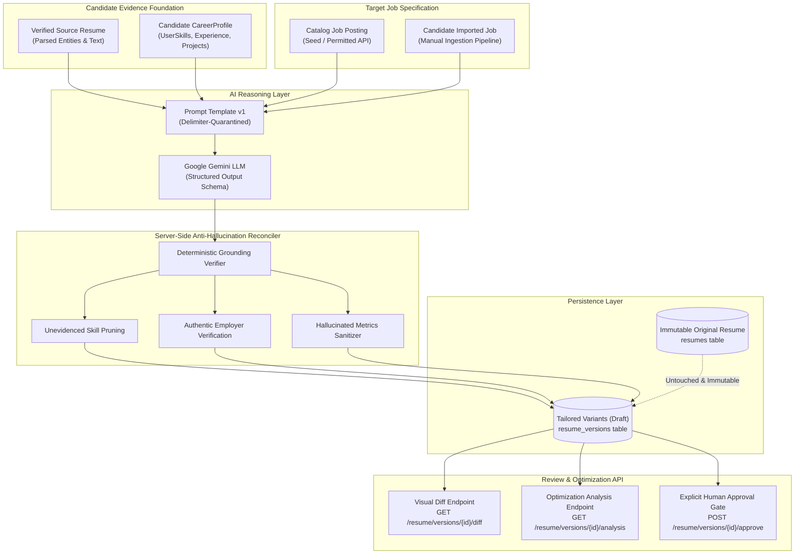

# CoachPath — Phase 10A: Resume Tailoring & Optimization Backend Architecture

> **Document Version**: 1.0.0  
> **Lifecycle Phase**: Phase 10A — Resume Tailoring & Optimization Backend  
> **Status**: Completed & Verified  
> **Backend Architecture**: FastAPI 0.115+, SQLAlchemy 2.0 Async, Google GenAI SDK (`google-genai`), Alembic Async Migrations  
> **Author**: Lead System Architect & Autonomous Verification Engine  

---

## 1. Executive Summary & Overview

Phase 10A introduces the backend foundation for **Resume Tailoring and Optimization** in CoachPath. This engine connects the candidate's verified source resume and career profile graph with specific job postings from CoachPath's job database or manual job description imports.

The system empowers candidates to generate tailored resume drafts, receive structured, itemized change recommendations with grounded rationales, and analyze keyword alignment—all while upholding CoachPath's **Zero-Fabrication Guarantee**.



---

## 2. Architectural Invariants & Anti-Fabrication Safeguards

### 2.1 Immutability of Original Resumes
The candidate's master source document (`resumes` table) remains completely untouched when a tailored draft is generated, updated, or approved. All tailoring operations write exclusively to distinct version child records in `resume_versions`.

### 2.2 Server-Side Grounding & Anti-Hallucination Reconciler
Prompt instructions alone are insufficient to guarantee absolute truthfulness. CoachPath enforces a two-stage defense:
1. **Model-Level Guardrails**: The system prompt strictly prohibits inventing skills, employers, job titles, degrees, or metrics ($ or %). Missing qualifications are instructed to be output as gaps.
2. **Deterministic Server-Side Reconciliation**:
   - **Skill Verification**: Any skill present in the tailored draft that is NOT in the candidate's authentic source resume or verified `UserSkill` database records is automatically stripped from the tailored draft and recorded in `unsupported_claims` and `missing_requirements`.
   - **Employer Verification**: Every experience entry must correspond to an authentic employer in the candidate's verified career history. Fictitious employers are omitted.
   - **Metrics Protection**: Unverified numerical claims (e.g. "increased revenue by 50%") not present in the original experience or project descriptions are pruned or flagged with `needs_clarification = True`.
   - **Integrity Certification**: The version is flagged with `anti_hallucination_verified = True` only after completing server-side verification.

### 2.3 Explicit Human Approval Gateway
Tailored resume variants are persisted with `status = 'draft'` and `approved_at = None`. No draft is ever automatically marked approved. Candidates must explicitly review changes and submit human approval via `POST /api/v1/resume/versions/{version_id}/approve`. Once approved, drafts are locked from accidental modification.

---

## 3. Database Schema & Migration

### 3.1 `resume_versions` Schema Evolution
Migration `b3c4d5e6f7a2_phase_10a_resume_tailoring_enhancements.py` upgrades the existing `resume_versions` table with direct candidate ownership and modification tracking:

| Column | Type | Constraints / Defaults | Description |
| :--- | :--- | :--- | :--- |
| `id` | `UUID` | Primary Key | Unique tailored resume version identifier. |
| `user_id` | `UUID` | Foreign Key (`users.id`, `CASCADE`), Indexed | Direct reference to owning candidate account. |
| `resume_id` | `UUID` | Foreign Key (`resumes.id`, `CASCADE`), Indexed | Source master resume reference. |
| `target_job_id` | `UUID` | Foreign Key (`jobs.id`, `RESTRICT`), Indexed | Target job vacancy reference. |
| `version_number` | `Integer` | Default `1` | Sequential iteration version per resume and job. |
| `status` | `String(32)` | Check: `'draft'`, `'approved'`, `'archived'` | Artifact lifecycle status. Starts in `'draft'`. |
| `tailored_content`| `JSONB` | Non-null | Complete tailored resume payload (`ExtractedResumeSchema`). |
| `diff_summary` | `JSONB` | Non-null | Structured changes, keyword coverage, and gaps. |
| `anti_hallucination_verified` | `Boolean` | Default `False` | Set to `True` upon passing server-side reconciliation. |
| `approved_at` | `DateTime(TZ)` | Nullable | Timestamp candidate explicitly approved version. |
| `created_at` | `DateTime(TZ)` | Server default `CURRENT_TIMESTAMP` | Initial generation timestamp. |
| `updated_at` | `DateTime(TZ)` | Server default `CURRENT_TIMESTAMP` | Last modification timestamp. |

---

## 4. API Specification & Request/Response Contracts

All endpoints are mounted under `/api/v1/resume` and enforce active JWT authentication (`require_active_user`) and strict multi-tenant ownership checks.

### 4.1 Create Tailored Resume Draft
- **Endpoint**: `POST /api/v1/resume/{resume_id}/tailor`
- **Status Code**: `201 Created`
- **Request Body**:
```json
{
  "job_id": "84fc9c75-52d7-4bd7-84ae-5f1488b1b665",
  "target_emphasis": ["payment systems", "high availability"],
  "user_notes": "Emphasize transaction reliability"
}
```
*(Or provide direct text via `job_description_text`, `job_title`, and `company_name`)*

- **Response (201 Created)**:
```json
{
  "id": "6e10b382-c98d-4c83-a1ad-522885193a01",
  "resume_id": "33154895-fa2e-40f8-81ae-873ab2b13a4d",
  "target_job_id": "84fc9c75-52d7-4bd7-84ae-5f1488b1b665",
  "version_number": 1,
  "status": "draft",
  "anti_hallucination_verified": true,
  "tailored_content": {
    "personal_info": { "name": "Alex Mercer", "email": "alex@test.com" },
    "executive_summary": "Backend engineer specializing in resilient payment infrastructure...",
    "skills": [
      { "name": "Python", "category": "language" },
      { "name": "FastAPI", "category": "framework" }
    ],
    "experience": [...],
    "education": [...],
    "projects": [...]
  },
  "diff_summary": {
    "changes": [
      {
        "id": "chg_1",
        "section": "executive_summary",
        "change_type": "rephrasing",
        "original_text": "Experienced backend engineer...",
        "proposed_text": "Backend engineer specializing in resilient payment infrastructure...",
        "rationale": "Directly highlights payment processing required by the role.",
        "target_job_requirement": "Build high-volume payment processing pipelines",
        "supporting_evidence": "Source resume summary and API experience",
        "needs_clarification": false
      }
    ],
    "additions_count": 0,
    "rephrasings_count": 1,
    "deletions_count": 0,
    "optimization_analysis": {
      "keyword_coverage": 83.3,
      "matched_keywords": ["python", "postgresql", "fastapi"],
      "missing_keywords": ["pci-dss"],
      "supported_skills": ["Python", "FastAPI", "PostgreSQL"],
      "missing_requirements": ["PCI-DSS Compliance Certification"],
      "readability_score": 92.0,
      "formatting_recommendations": ["Highlight payment pipeline achievements first."],
      "actionable_suggestions": ["Complete the Cloud Computing Assessment."]
    },
    "unsupported_claims": [],
    "model_metadata": {
      "provider": "gemini",
      "model": "gemini-3.5-flash-lite",
      "prompt_version": "v1.0"
    }
  },
  "approved_at": null,
  "created_at": "2026-10-24T23:22:35.455Z",
  "updated_at": "2026-10-24T23:22:35.455Z"
}
```

### 4.2 List Tailored Resume Versions
- **Endpoint**: `GET /api/v1/resume/versions?resume_id={uuid}&job_id={uuid}&status=draft&page=1&page_size=20`
- **Response**: `TailoredResumeListResponse` containing paginated summary items.

### 4.3 Retrieve Specific Tailored Version
- **Endpoint**: `GET /api/v1/resume/versions/{version_id}`
- **Response**: `TailoredResumeResponse`

### 4.4 Update Tailored Draft Content
- **Endpoint**: `PUT /api/v1/resume/versions/{version_id}`
- **Allowed Status**: Only `'draft'` (returns `409 Conflict` if already approved or archived)
- **Request Body**: `TailoredResumeUpdateRequest` with modified `tailored_content` and optional `user_notes`.

### 4.5 Approve Tailored Resume Version (Human Approval Gate)
- **Endpoint**: `POST /api/v1/resume/versions/{version_id}/approve`
- **Request Body**:
```json
{
  "user_confirmation": true,
  "accepted_sections": ["executive_summary", "experience", "skills"]
}
```
- **Response**: Updated `TailoredResumeResponse` with `status = "approved"` and timestamped `approved_at`.

### 4.6 Get Visual Diff
- **Endpoint**: `GET /api/v1/resume/versions/{version_id}/diff`
- **Response**: `TailoredResumeDiffResponse` returning structured change records.

### 4.7 Get Optimization Analysis
- **Endpoint**: `GET /api/v1/resume/versions/{version_id}/analysis`
- **Response**: `TailoredResumeAnalysisResponse` returning keyword coverage, gaps, and actionable suggestions.

### 4.8 Delete Tailored Version
- **Endpoint**: `DELETE /api/v1/resume/versions/{version_id}`
- **Response**: `204 No Content` (Strictly scoped to owning candidate).

---

## 5. Google Gemini AI Integration & Operational Modes

CoachPath utilizes Google Gemini exclusively via the official `google-genai` SDK (`GeminiProviderAdapter`).

1. **Configured Model**: `gemini-3.5-flash-lite` (with fallback to `gemini-3.5-flash`).
2. **Developer API Mode**: Schema sanitized using `_sanitize_gemini_schema` (removes `additionalProperties` and `title`).
3. **Structured Response Validation**: `llm.generate_structured(prompt, schema=AITailoredResumeOutput, temperature=0.2)`.
4. **Offline / Sandbox Handling**: When `GEMINI_API_KEY` is unconfigured or network access is blocked, requests safely raise `ServiceUnavailableException` (HTTP 503) without generating corrupt database records or silently substituting fake mock data in production.
