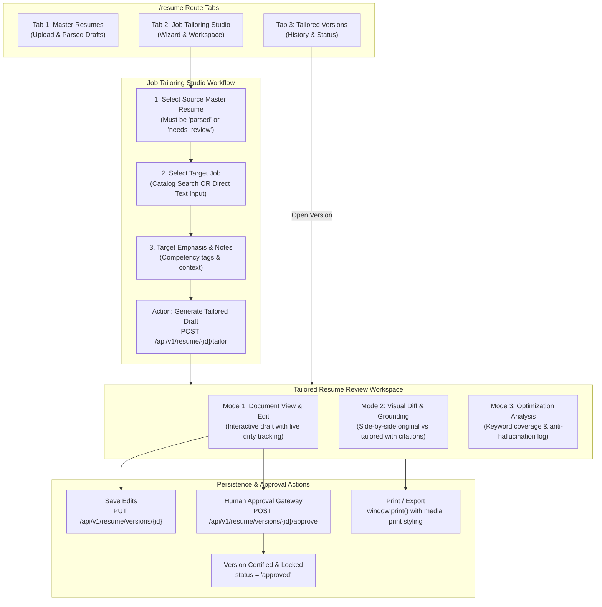

# CoachPath — Phase 10B: Resume Tailoring & Optimization Frontend Architecture

> **Document Version**: 1.0.0  
> **Lifecycle Phase**: Phase 10B — Resume Tailoring & Optimization Frontend Integration  
> **Status**: Completed & Verified  
> **Frontend Architecture**: Next.js 14 App Router, TypeScript, React 18, Tailwind CSS, Lucide Icons, Framer Motion  
> **Author**: Lead Frontend Architect & Autonomous Verification Engine  

---

## 1. Executive Summary & Overview

Phase 10B delivers the complete, polished frontend user experience for **Resume Tailoring and Optimization** in CoachPath. This release connects the verified Phase 10A backend engine (`POST /api/v1/resume/{resume_id}/tailor`, `resume_versions` table, and server-side grounding reconciler) with an intuitive, multi-stage tailoring workspace.

The frontend is integrated directly into the established `/resume` route without modifying existing master resume upload, parsing, or profile confirmation workflows. Candidates can now:
1. Select an eligible, verified source resume from their authenticated account.
2. Select a target job opportunity from CoachPath's curated job catalog or paste a custom job description ($\ge 50$ characters).
3. Specify optional competencies to emphasize and candidate notes.
4. Generate an evidence-grounded tailored resume variant.
5. Review the tailored draft across three cohesive modes:
   - **Document Preview & Edit**: Human-editable document view allowing adjustments before certification.
   - **Visual Diff & Evidence Grounding**: Side-by-side or stacked before-and-after change list with grounding rationales and target requirement citations.
   - **Optimization Analysis**: Quantitative keyword coverage meter, evidenced keywords, honest missing requirements, actionable suggestions, and anti-hallucination audit logs.
6. Submit explicit certification via the **Human Approval Gateway**, locking the version from accidental edits.
7. Manage version history, inspect past drafts, and delete versions under strict tenant ownership.



---

## 2. Architecture & File Structure

The Phase 10B frontend implementation introduces modular, reusable components in `frontend/src/components/resume/` and integrates them into `frontend/src/app/(app)/resume/page.tsx`:

| File Path | Component / Layer | Primary Purpose |
| :--- | :--- | :--- |
| [`frontend/src/types/index.ts`](file:///Users/anmolsharma/Desktop/Coach_Path/frontend/src/types/index.ts#L1112-L1233) | Domain Types | Fully typed TypeScript interfaces for `StructuredChangeItem`, `OptimizationAnalysis`, `DiffSummarySchema`, `ResumeTailorRequest`, `TailoredResumeResponse`, `TailoredResumeListItem`, and approval payloads. |
| [`frontend/src/lib/resume-client.ts`](file:///Users/anmolsharma/Desktop/Coach_Path/frontend/src/lib/resume-client.ts#L98-L179) | API Client Layer | Added typed methods for `tailorResume`, `listTailoredVersions`, `getTailoredVersion`, `updateTailoredVersion`, `approveTailoredVersion`, `getTailoredDiff`, `getTailoredAnalysis`, and `deleteTailoredVersion`. |
| [`frontend/src/components/resume/resume-tailoring-wizard.tsx`](file:///Users/anmolsharma/Desktop/Coach_Path/frontend/src/components/resume/resume-tailoring-wizard.tsx) | Tailoring Wizard | 3-step configuration interface for source resume selection, target job selection (catalog search or direct text), emphasis tags, and safe generation trigger. |
| [`frontend/src/components/resume/tailored-resume-workspace.tsx`](file:///Users/anmolsharma/Desktop/Coach_Path/frontend/src/components/resume/tailored-resume-workspace.tsx) | Review Workspace | Document preview & inline editor, visual diff comparator with grounding rationales, optimization analysis breakdown, and print styles. |
| [`frontend/src/components/resume/tailored-approval-dialog.tsx`](file:///Users/anmolsharma/Desktop/Coach_Path/frontend/src/components/resume/tailored-approval-dialog.tsx) | Human Approval Gateway | Modal with section checklist and mandatory confirmation checkbox ensuring candidates review all claims before certifying. |
| [`frontend/src/components/resume/tailored-versions-list.tsx`](file:///Users/anmolsharma/Desktop/Coach_Path/frontend/src/components/resume/tailored-versions-list.tsx) | Version History View | Card and table list of past tailored variants with status filtering (`all`, `draft`, `approved`), search by company/title, keyword coverage badges, and management actions. |
| [`frontend/src/components/resume/tailored-delete-dialog.tsx`](file:///Users/anmolsharma/Desktop/Coach_Path/frontend/src/components/resume/tailored-delete-dialog.tsx) | Safety Modal | Confirmation dialog for permanently deleting tailored resume variants while preserving original master files. |
| [`frontend/src/app/(app)/resume/page.tsx`](file:///Users/anmolsharma/Desktop/Coach_Path/frontend/src/app/(app)/resume/page.tsx) | Route Page Controller | Top-level tabbed controller supporting deep-linking (`?tab=tailor`, `?job_id=...`, `?version_id=...`), notifications, state management, and master resume fallback. |

---

## 3. Verified Backend API Contracts Used

All frontend operations communicate directly with the verified Phase 10A FastAPI endpoints mounted under `/api/v1/resume`:

```
POST   /api/v1/resume/{resume_id}/tailor        -> Initiates AI tailoring & server-side grounding reconciliation
GET    /api/v1/resume/versions                  -> Returns paginated tailored versions for authenticated user
GET    /api/v1/resume/versions/{version_id}     -> Retrieves complete tailored resume version payload
PUT    /api/v1/resume/versions/{version_id}     -> Updates editable draft content (returns 409 if approved)
POST   /api/v1/resume/versions/{version_id}/approve -> Explicit human approval gate (locks version)
GET    /api/v1/resume/versions/{version_id}/diff    -> Returns structured itemized before-and-after change list
GET    /api/v1/resume/versions/{version_id}/analysis-> Returns quantitative keyword coverage and gap analysis
DELETE /api/v1/resume/versions/{version_id}     -> Deletes version permanently under strict user ownership check
```

---

## 4. Feature Capabilities & User Workflows

### 4.1 Step 1: Source Resume Selection
- Displays all resumes uploaded and processed for the candidate.
- Filters and highlights eligible source resumes (status `parsed` or `needs_review`).
- Displays file metadata: filename, upload date, file size, primary source badge.
- If no eligible resumes exist, renders a clear callout with a direct action to switch to the Upload tab.
- Automatically selects the primary source resume by default.

### 4.2 Step 2: Target Job Selection
- **Catalog Search Mode**:
  - Real-time search by job title, company name, or technology keyword.
  - Fetches real job postings from `jobClient.searchJobs()`.
  - Displays company name, location, remote flexibility tag, and salary range.
  - Selected job is highlighted with a check badge.
- **Direct Job Description Text Mode**:
  - Allows pasting raw job description text from external sources.
  - Requires Job Title, Company Name, and Job Description.
  - Real-time character counter enforcing backend minimum length ($\ge 50$ characters).
  - Preserves user's long-term career profile while tailoring to the specific posting.

### 4.3 Step 3: Optional Emphasis & Notes
- Candidate can add specific competency tags to emphasize (e.g., `PostgreSQL Indexing`, `High-Throughput Webhooks`, `Distributed Transactions`).
- Optional candidate notes textarea for specific tailoring instructions.

### 4.4 Generation & Loading States
- Generation button requires valid source resume and valid target job.
- Loading indicator with animated spinner (`isGenerating`).
- Duplicate-submission guard prevents accidental double-clicking.
- Error handling displays actionable RFC 7807 error messages if the service is unavailable or input is invalid.

### 4.5 Tailored Resume Review Workspace
- **Document Preview & Edit Mode**:
  - Document-style presentation with candidate contact header, executive summary, technical skills, work experience with bullet points, projects, and education.
  - In `draft` mode: Executive summary and bullet points are editable in-place; skills can be added or removed.
  - Unsaved change indicator appears when local edits are made, with "Save Edits" and "Discard" actions.
- **Visual Diff & Evidence Grounding Mode**:
  - Itemized before-and-after cards displaying section, change type (`addition`, `rephrasing`, `emphasis`, `reordering`, `omission`), original baseline text, and proposed tailored text.
  - Section filter (All, Executive Summary, Experience, Skills, Projects).
  - Side-by-side or stacked layout toggle.
  - Evidence Callout: Displays grounding rationale ("Why this improves score"), target job requirement addressed, and supporting evidence from candidate history.
  - Highlights recommendations flagged with `needs_clarification = True`.
- **Optimization Analysis Mode**:
  - Quantitative keyword coverage meter (`keyword_coverage` %).
  - Evidenced keywords vs unevidenced missing keywords.
  - Supported skills vs genuine missing job requirements.
  - Readability score, formatting recommendations, and actionable suggestions.
  - **Anti-Hallucination Audit Log**: Explicitly surfaces any unevidenced skills or claims stripped by the server-side reconciler, reinforcing candidate trust.

### 4.6 Explicit Human Approval Gateway
- Tailored drafts begin in `status = 'draft'`.
- Clicking "Approve Version" opens the `TailoredApprovalDialog`.
- Requires selecting accepted sections and checking the mandatory confirmation box:
  *"I verify that I have reviewed the tailored content. All bullet points, skills, and metrics accurately reflect my authentic experience and contain zero fabricated claims."*
- Calls `POST /api/v1/resume/versions/{id}/approve` with `user_confirmation: true`.
- Once approved, transitions to `status = 'approved'`, records `approved_at`, locks editing, and displays a permanent "Version Certified & Locked" badge.
- Discloses that approval certifies the version internally and will **never auto-apply** to jobs or contact recruiters.

### 4.7 Version History & Deletion
- Lists all versions created by the user with version number, target role, company, status badge, keyword coverage, and change counts.
- Search and filter by status (`all`, `draft`, `approved`).
- Allows reopening past versions or deleting obsolete versions with confirmation.

---

## 5. Security, Immutability & Privacy Safeguards

1. **Original Resume Immutability**:
   - Master resume rows in `resumes` table (`extracted_data`, `parsed_text`, `status`, `updated_at`) are never mutated during tailoring or editing. All modifications operate exclusively on child `resume_versions` records.
2. **Zero-Fabrication & Anti-Hallucination Reconciler**:
   - The UI displays unevidenced claims stripped by the backend in a dedicated audit log, transparently explaining that claims lacking evidence were pruned to protect candidate credibility.
3. **Multi-Tenant Ownership & Privacy**:
   - All client calls rely on the authenticated user's JWT session cookie. No client-supplied ownership IDs are used.
   - Cross-user access returns `403 Forbidden` and is handled gracefully with an error alert.
4. **Credential Isolation**:
   - Zero LLM API keys or secrets are exposed in browser bundles or client-side code.
   - All AI calls are mediated through the backend `resume_tailoring_service` and `GeminiProviderAdapter`.

---

## 6. Verification Results

- **Frontend Linting**: `npm --prefix frontend run lint` passed with **0 warnings and 0 errors**.
- **Frontend Production Build**: `npm --prefix frontend run build` compiled successfully (**25/25 static routes generated**, `/resume` at 27.9 kB).
- **Backend Integration Tests**: All 21 tests in `backend/tests/test_resume_tailoring.py` and `backend/tests/test_phase10b_frontend_integration.py` passed with **0 failures and 0 regressions**.
