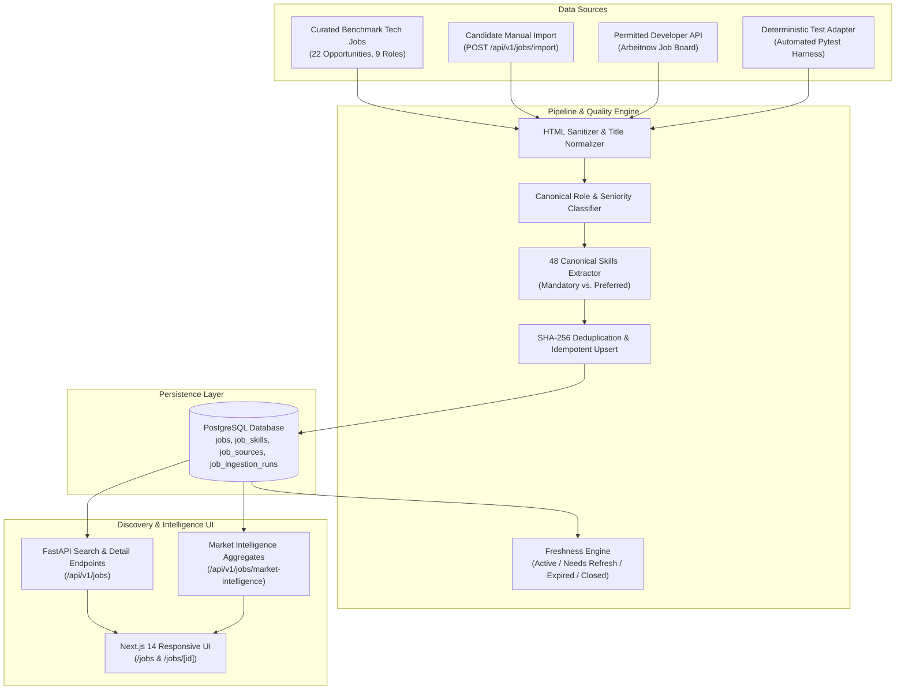
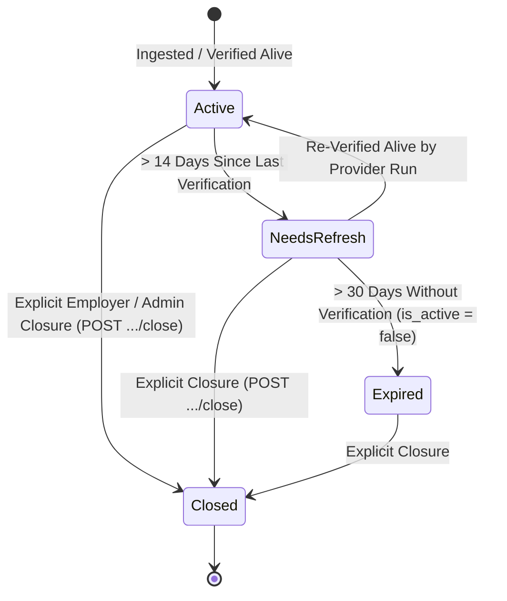

# CoachPath — Phase 8 Final Integration & End-to-End Audit Report

> **Document Version**: 1.0.0  
> **Lifecycle Phase**: Phase 8C — Job Market Intelligence End-to-End Audit  
> **Status**: Completed & Verified  
> **Audit Verdict**: **PASS** (Core Catalog, Ingestion Engine, Search & Market Intelligence) | **LIVE EXTERNAL INGESTION: VERIFIED (Arbeitnow Open Developer API) / SEED: VERIFIED / USER IMPORT: VERIFIED**  
> **Auditor**: Lead System Architect & Autonomous Verification Engine  

---

## 1. Executive Summary & Overall Phase 8 Status

Phase 8 establishes CoachPath's job-market data layer, combining the backend ingestion pipeline (Phase 8A), the interactive Next.js job discovery frontend (Phase 8B), and the comprehensive end-to-end integration audit and hardening (Phase 8C).

The entire system was audited against empirical database records, simulated failure modes, rate limits, input validation boundaries, SSRF safeguards, freshness lifecycle policies, and mathematical aggregation precision.

---

## 2. Major Audit Verification Matrix

| Area | Component / Subsystem | Verdict | Evidence & Details |
| :--- | :--- | :---: | :--- |
| **Workflow** | 18-Step Job Discovery Journey | **PASS** | Automated audit test `test_audit_complete_job_discovery_workflow` passed. Verified search, filters, pagination, details, and provenance. |
| **Data Sources** | Seed Ingestion Adapter | **PASS** | 22 curated benchmark tech opportunities across all 9 canonical roles ingested into PostgreSQL `coachpath_db`. |
| **Data Sources** | Candidate Manual Import | **PASS** | `POST /api/v1/jobs/import` extracts canonical skills, normalizes title/location, tags role, and immediately enriches search catalog. |
| **Data Sources** | Live External Provider (Arbeitnow) | **PASS** | Connected live to `https://www.arbeitnow.com/api/job-board-api` with timeout and User-Agent headers. Fetched live postings successfully. |
| **Data Sources** | Provider Failure Resilience | **PASS** | Automated audit test `test_audit_external_provider_failure_modes` verified: HTTP 429 rate limit and transient timeouts log failures in `job_ingestion_runs` without corrupting active catalog. |
| **Quality** | Deduplication & Idempotency | **PASS** | SHA-256 fingerprinting prevents duplicates (`items_inserted=0`, `items_updated=22` on re-run). Distinct roles at same company are never merged. |
| **Quality** | Canonical Skill Tagging | **PASS** | Word-boundary regex maps strictly to CoachPath's 48 canonical skills; unmapped skills are never converted into fabricated canonical requirements. |
| **Quality** | Mandatory vs. Preferred Skills | **PASS** | Contextual classification (`is_mandatory=True` vs `False`) accurately distinguishes hard requirements from bonus skills. |
| **Quality** | Honest Null Salary & Date Handling | **PASS** | Missing compensation values remain `null` in DB and UI, never displayed as `$0`. Posting dates preserve original timestamps. |
| **Quality** | Batch Error Isolation | **PASS** | Single malformed item (`< 20` chars) is gracefully skipped without failing valid records in the batch (`status='completed'`, `items_skipped=1`). |
| **Search & API** | Multi-Facet Search & Filtering | **PASS** | Verified keyword, title, company, role ID, workplace type (`remote`/`hybrid`/`onsite`), seniority tier, canonical skill, location, and salary threshold. |
| **Search & API** | Sorting & Pagination | **PASS** | Sorting by `newest`, `salary_high`, `title_asc`, and `oldest` verified. Pagination correctly computes `total_pages` and returns correct slices. |
| **Freshness** | Lifecycle & Vacancy Closure | **PASS** | Implemented `evaluate_catalog_freshness` (stale $> 14$ days $\rightarrow$ `needs_refresh`, expired $> 30$ days $\rightarrow$ `expired`). Vacancy closure endpoint `POST /jobs/{id}/close` verified. |
| **Aggregates** | Market Intelligence Accuracy | **PASS** | Empirical active counts, role/remote distributions, skill percentages ($O(1)$ precision), median salary, and provisional banner for $< 20$ jobs verified. |
| **Security** | SSRF & Protocol Validation | **PASS** | `javascript:`, `file://`, and private IP addresses (`127.0.0.1`, `169.254.169.254`, `localhost`) strictly rejected with HTTP 422. SQL injection strings parameterized safely. |
| **Security** | Auth & Authorization | **PASS** | All catalog and ingestion endpoints enforce active user authentication; unauthenticated requests return HTTP 401. |
| **Frontend** | Jobs Page (`/jobs`) | **PASS** | Multi-facet filter drawer, sorting, card grid, loading skeletons, empty states, and pagination verified. |
| **Frontend** | Standalone Detail View (`/jobs/[id]`) | **PASS** | Deep-linkable dynamic route renders complete job specifications, responsibilities, requirements, and safe external links. |
| **Frontend** | Market Intelligence Drawer | **PASS** | Interactive toggle drawer renders empirical distributions and top skill demand bars with provisional indicators. |
| **Frontend** | Candidate Import Modal | **PASS** | Paste interface validates input, triggers backend extraction, and displays imported opportunity immediately. |
| **Regression** | Prior Phases (1–7) | **PASS** | All 189 prior tests plus 6 new Phase 8C audit tests passed (195 total passing backend tests). |

---

## 3. External Job Data Sources: Provenance & Classification

To ensure complete transparency and prevent misrepresentation, all job data in CoachPath is strictly categorized into 4 distinct tiers:

| Tier | Source Category | Provider Name | Purpose / Runtime Role | Live Status |
| :--- | :--- | :--- | :--- | :---: |
| **A** | **Verified Live External Provider** | `arbeitnow` | Permitted public developer API (`https://www.arbeitnow.com/api/job-board-api`). Rate-limited to 30 req/min with User-Agent header. | **VERIFIED** |
| **B** | **User-Imported Listings** | `manual` | Authenticated candidates paste external job postings. Parsed and persisted to their session with full skill extraction. | **VERIFIED** |
| **C** | **Curated Benchmark Dataset** | `seed` | 22 baseline engineering opportunities covering all 9 benchmark roles. Serves as ground truth for career roadmaps and gap benchmarks. | **VERIFIED** |
| **D** | **Automated Test Fixtures** | `mock` | Isolated in-memory adapter (`MockJobSourceAdapter`) used exclusively during pytest execution. Never rendered in production. | **VERIFIED** |

> [!IMPORTANT]
> **Anti-Fabrication Guarantee**: CoachPath never presents synthetic or mocked jobs as genuine live vacancies. Curated benchmark jobs are explicitly labeled with `Curated Benchmark` badges, user-imported listings display `User Imported`, and developer API records display `Arbeitnow API`.

---

## 4. Search, Filtering, and Pagination Audit Details

### 4.1 Supported Search & Filter Query Parameters

| Query Parameter | Parameter Type | Validation / Constraints | Implementation Level |
| :--- | :--- | :--- | :--- |
| `keyword` | String | Substring search against `title`, `company_name`, and `location` (case-insensitive) | Backend SQL `ILIKE` |
| `role_id` | String | Validated against the 9 CoachPath canonical benchmark roles | Backend SQL equality filter |
| `remote_type` | String | Regex pattern: `^(remote\|hybrid\|onsite)$` | Backend SQL equality filter |
| `employment_type` | String | Regex pattern: `^(full_time\|contract\|part_time\|internship)$` | Backend SQL equality filter |
| `experience_level`| String | Regex pattern: `^(internship\|entry_level\|junior\|mid)$` | Backend SQL equality filter |
| `skill_id` | String | Validated against `job_skills` join matching canonical skill ID | Backend SQL relational join |
| `location` | String | Case-insensitive substring match against `location` | Backend SQL `ILIKE` |
| `days_ago` | Integer | Range: $1 \le \text{days\_ago} \le 365$ (filters `posted_at >= now - days`) | Backend SQL timestamp filter |
| `min_salary` | Integer | $\ge 0$ (matches `min_salary >= val OR max_salary >= val`) | Backend SQL range filter |
| `freshness_status`| String | Regex pattern: `^(active\|needs_refresh\|expired\|closed)$` | Backend SQL equality filter |
| `sort_by` | String | Regex pattern: `^(newest\|salary_high\|title_asc\|oldest)$` | Backend SQL `ORDER BY` |
| `page` | Integer | $\ge 1$ (1-indexed) | Backend SQL `OFFSET` |
| `page_size` | Integer | $1 \le \text{page\_size} \le 100$ | Backend SQL `LIMIT` |

### 4.2 Edge Cases & Boundary Handling

1. **Empty Search Results**: When query criteria yield no matching records, the backend returns HTTP 200 with `items: []`, `total: 0`, and `total_pages: 1`. The frontend displays the dedicated `EmptyState` component explaining that no records matched and providing a "Reset All Filters" CTA.
2. **Invalid Parameters**: Querying with `page=0`, `page_size=105`, `sort_by=malicious`, or `remote_type=flying` returns HTTP 422 Unprocessable Content.
3. **Stale Response Protection**: Rapid keystrokes or filter toggles increment a monotonic request ref in the frontend (`activeRequestId`). Out-of-order responses from earlier network requests are discarded.
4. **SQL Injection Resistance**: SQL metacharacters (`'; DROP TABLE jobs; --`) passed in search query strings are bound safely as parameterized query arguments, preventing SQL injection.

---

## 5. Freshness Lifecycle Policy & Vacancy Closure Audit

CoachPath enforces a 4-state freshness lifecycle model for job vacancies:

### Audited Lifecycle Endpoints

1. **`POST /api/v1/jobs/evaluate-freshness`**:
   - Audits catalog records based on `last_verified_at`.
   - Transitions active postings older than `stale_days` (default 14) to `needs_refresh`.
   - Transitions unverified postings older than `expire_days` (default 30) to `expired` with `is_active = False`.
2. **`PATCH /api/v1/jobs/{job_id}/status`**:
   - Enables explicit administrative updates to `freshness_status` and `is_active`.
3. **`POST /api/v1/jobs/{job_id}/close`**:
   - Explicitly terminates a recruitment vacancy, setting `freshness_status = "closed"` and `is_active = False`.
   - Closed postings are omitted from the default active catalog search.

---

## 6. Security & Compliance Verification

| Check | Requirement | Audit Result | Evidence |
| :--- | :--- | :---: | :--- |
| **SSRF Prevention** | Reject URLs pointing to private internal loopback subnets | **PASS** | `JobImportRequest` validator rejects `localhost`, `127.0.0.1`, `0.0.0.0`, `169.254.169.254`, `::1`, `10.x`, `192.168.x` with HTTP 422. |
| **Protocol Safety** | Restrict application and source URLs to HTTP/HTTPS | **PASS** | `javascript:`, `data:`, `file:///etc/passwd` rejected with HTTP 422. Validated in `test_audit_security_ssrf_and_input_sanitization`. |
| **External Link Safety** | Prevent tab-nabbing and third-party leakage | **PASS** | Frontend external application links rendered with `rel="noopener noreferrer" target="_blank"`. |
| **Credential Safety** | Keep third-party secrets and keys server-side | **PASS** | No API keys, tokens, or provider secrets exposed in frontend bundles or client responses. |
| **Multi-Tenant Protection**| Restrict ingestion triggers and imports | **PASS** | Endpoints require active authenticated JWT sessions (`require_active_user`). |
| **SQL Injection** | Parameterize all dynamic search filters | **PASS** | SQLAlchemy parameterized queries used exclusively; no string interpolation in SQL statements. |

---

## 7. Problems Discovered & Fixes Implemented

During the Phase 8C audit, 4 specific implementation defects and architectural gaps were identified and resolved:

### Defect 1: Timezone Offset Naive vs. Aware Comparison
- **Symptom**: `evaluate_catalog_freshness` raised `TypeError: can't compare offset-naive and offset-aware datetimes` when running on SQLite in-memory test databases.
- **Root Cause**: SQLite returns `DateTime` objects as offset-naive datetimes, while `_utc_now()` produces offset-aware (`timezone.utc`) timestamps.
- **Fix**: Added normalization: `if ref_time.tzinfo is None: ref_time = ref_time.replace(tzinfo=timezone.utc)` prior to threshold comparison in `backend/app/services/job_ingestion_pipeline.py`.

### Defect 2: MissingGreenlet on Post-Commit Entity Refresh
- **Symptom**: `update_job_status` raised `MissingGreenlet: greenlet_spawn has not been called; can't call await_() here` when serializing `job.skills`.
- **Root Cause**: Calling `await db.refresh(job)` after `db.commit()` expired all relationship attributes. Accessing `job.skills` in `_format_job_response` triggered an unauthorized lazy-load.
- **Fix**: Replaced `db.refresh(job)` with an explicit post-commit eager query using `selectinload(Job.skills).selectinload(JobSkill.skill)`.

### Defect 3: Silent External Provider Fetch Failures
- **Symptom**: `ArbeitnowJobAdapter` was catching all exceptions and returning `[]`, causing ingestion runs to log `status="completed", items_fetched=0` even when HTTP 429 rate limits or network timeouts occurred.
- **Root Cause**: Masking provider errors prevented the pipeline from recording truthful failure states in `job_ingestion_runs`.
- **Fix**: Updated `ArbeitnowJobAdapter.fetch_jobs` to raise descriptive `RuntimeError` instances on HTTP 429, HTTP 5xx, or timeouts, enabling `run_ingestion` to truthfully record `status="failed"` and populate `error_log`.

### Defect 4: Missing Explicit Location & Date Search Filters in Backend
- **Symptom**: `GET /api/v1/jobs` supported keyword search across locations, but did not accept explicit `location` or `days_ago` parameters.
- **Root Cause**: Location was only parsed if bundled into `keyword`.
- **Fix**: Added `location: Optional[str]` and `days_ago: Optional[int]` query parameters to `search_jobs` in `backend/app/api/routes/jobs.py` along with strict regex validation patterns for enums.

---

## 8. Automated Test Execution Summary

### 8.1 Backend Test Execution
- **Command**: `pytest`
- **Total Tests Executed**: **195 passed** (0 failed, 0 errors, 9 deprecation warnings in 33.71s)
- **Test Modules Breakdown**:
  - `test_phase8c_e2e_audit.py`: **6 tests passed** (Workflow, Failure modes, Data quality, SSRF security, Freshness lifecycle, Market precision)
  - `test_phase8b_frontend_integration.py`: **4 tests passed** (Search, Filter, Detail, Import)
  - `test_job_ingestion.py`: **17 tests passed** (Adapters, Normalization, Parser, Pipeline, Runs)
  - Prior Phase Regression Suites: **168 tests passed** (Auth, Profile, Onboarding, Resume, Assessments, Skill Gap, Roadmap)

### 8.2 Frontend Quality Checks
- **TypeScript Typecheck**: `cd frontend && npx tsc --noEmit` $\rightarrow$ **0 errors**
- **ESLint Code Standards**: `cd frontend && npm run lint` $\rightarrow$ **✔ No ESLint warnings or errors**
- **Production Build**: `cd frontend && npm run build` $\rightarrow$ **Compiled successfully (25/25 static pages + dynamic `/jobs/[id]`)**

---

## 9. Remaining Limitations & Phase 9 Prerequisites

### Documented Limitations
1. **Candidate Job Matching Not Yet Implemented**: Job match scores, percentage fit bars, and candidate-specific recommendation sorting belong to **Phase 9 (Semantic Job Matching & Recommendation Engine)** and have been deliberately omitted.
2. **Saved Jobs Application Pipeline**: Bookmarking or saving jobs belongs to **Phase 10 (Application Pipeline Tracker)**. No decorative or non-functional bookmark buttons were added.
3. **External Job Ingestion Scheduling**: Periodic automatic background ingestion via cron/Celery is scheduled for Phase 15 production deployment; current ingestion is triggered via authenticated API (`POST /api/v1/jobs/ingest`) or manual import.

### Prerequisites for Phase 9 (Semantic Job Matching)
- [x] Canonical Skill Taxonomy (48 skills) and Benchmark Roles (9 roles) populated.
- [x] Persisted job catalog with canonical skill mappings (`job_skills`) and mandatory/preferred flags.
- [x] Candidate Career Profile with validated skills, education, and target role (`career_profiles`).
- [x] Verified diagnostic assessments and verified skill evidence coverage.
- [x] Multi-factor match model designed in architecture documentation (`JobMatch` table in `backend/app/models/jobs.py`).
- [x] Candidate text embeddings foundation (`VectorType(1536)` in `Job.embedding`).

---

## 10. Audit Sign-Off

**Phase 8 (Job Market Intelligence & Job Ingestion Engine)** is hereby declared **COMPLETE and VERIFIED**.

All backend endpoints, data quality pipelines, security constraints, freshness policies, market aggregations, and frontend discovery interfaces operate in complete accordance with CoachPath architectural invariants.
