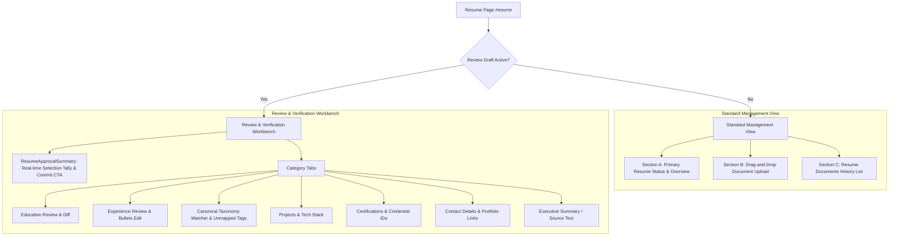
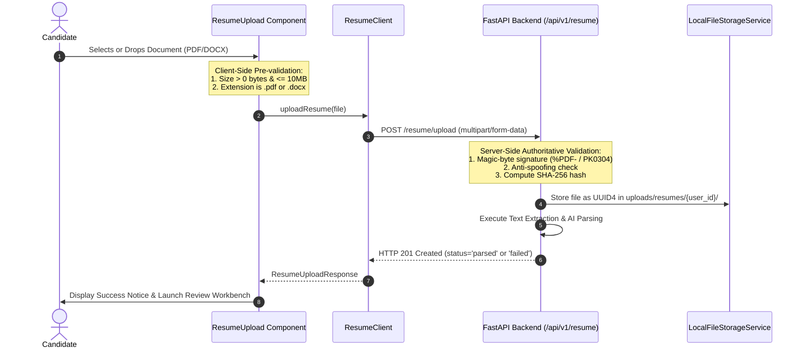
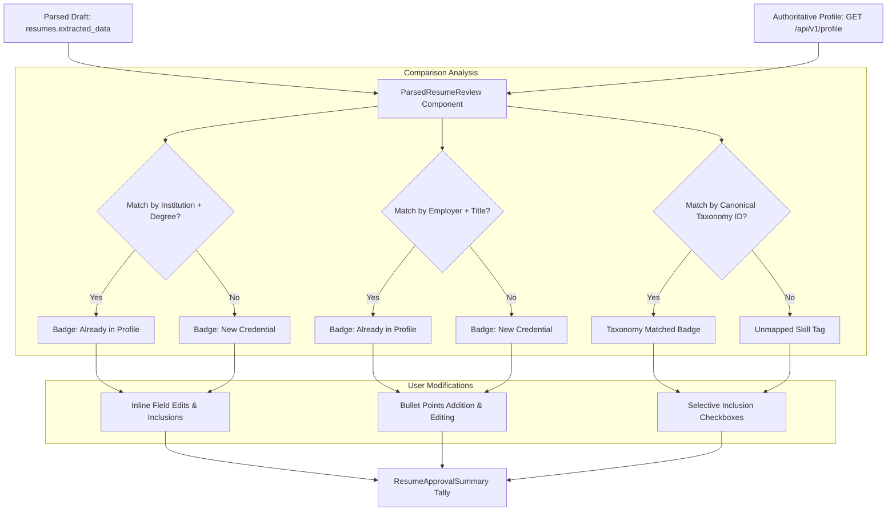
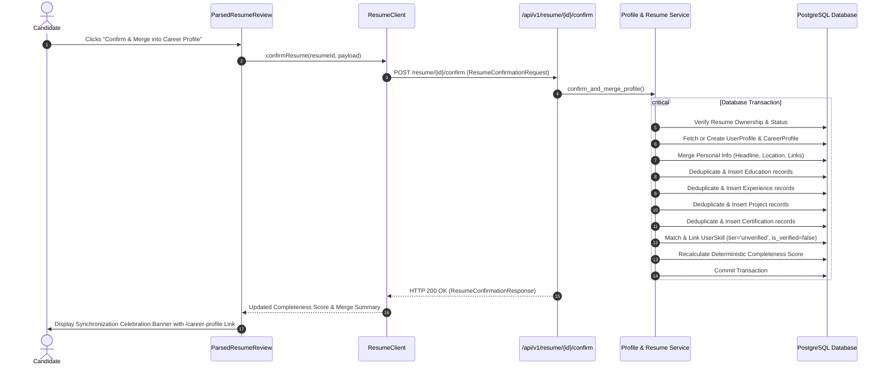

# CoachPath Resume Frontend & Review Architecture Specification

> **Document Version**: 1.0.0  
> **Lifecycle Phase**: Phase 5B — Resume Frontend & Review Workflow  
> **Status**: Completed & Verified  
> **Target Audience**: Frontend Engineering, AI Engineering, Product, Security  

---

## 1. Executive Summary

Phase 5B delivers CoachPath's interactive resume workbench: **Resume Ingestion UI, Real-Time Processing Monitoring, and Candidate Review & Approval Workflow**.

While Phase 5A established the backend storage, deterministic text extraction, and zero-fabrication AI parsing pipeline, Phase 5B bridges these capabilities to the user interface on `/resume`. The system empowers candidates to upload their documents, inspect extracted credentials in real time, compare them against their existing career profile, correct or discard any ambiguous details, and explicitly confirm the safe merging of approved information into their central career profile.

### Core Architectural Invariant: Explicit Approval Gate

$$\text{Upload PDF/DOCX} \longrightarrow \text{Storage \& Parsing} \longrightarrow \text{Isolated Draft Review} \longrightarrow \text{Candidate Selection \& Edits} \longrightarrow \text{Explicit Confirm CTA} \longrightarrow \text{Transactional DB Merge}$$

1. **Zero Silent Profile Mutations**: The candidate's `CareerProfile` and `UserSkill` records in PostgreSQL are **never** mutated by page loading or file parsing. All profile updates require an explicit human confirmation POST request.
2. **Draft Persistence**: Extraction results remain stored as a reviewable JSONB draft in `resumes.extracted_data` until approved.
3. **Multi-Tenant Protection**: All resume retrieval, downloading, retry, review, deletion, and confirmation actions enforce strict ownership checks. Candidates cannot view or manipulate other users' files or drafts.
4. **Anti-Hallucination Labeling**: Extracted credentials and skills merged into the profile are flagged with `primary_source='extracted'` and `proficiency_tier='unverified'` with `is_verified=False`. They are never treated as independently verified assessments.

---

## 2. Information Architecture & Page Structure (`/resume`)

The resume management route (`/resume`) is organized into an adaptive view hierarchy:

### Component Hierarchy

| Component | File Path | Role |
|---|---|---|
| `ResumePage` | `frontend/src/app/(app)/resume/page.tsx` | Main orchestrator, polling coordinator, profile synchronizer. |
| `ResumeUpload` | `frontend/src/components/resume/resume-upload.tsx` | Drag-and-drop file uploader with client validation and progress indicator. |
| `ResumeProcessingStatusCard` | `frontend/src/components/resume/resume-processing-status.tsx` | Primary resume processing state card with category-aware error messages and retry action. |
| `ResumeCard` | `frontend/src/components/resume/resume-card.tsx` | Individual resume document presentation with download, retry, review, and delete actions. |
| `ResumeHistory` | `frontend/src/components/resume/resume-history.tsx` | Resume archive list with loading skeletons and empty states. |
| `ParsedResumeReview` | `frontend/src/components/resume/parsed-resume-review.tsx` | Multi-tab review workbench with inline editing and conflict indicators. |
| `ProfileConflictIndicator` | `frontend/src/components/resume/profile-conflict-indicator.tsx` | Visual badge comparing draft entities against existing `CareerProfile` records. |
| `ResumeApprovalSummary` | `frontend/src/components/resume/resume-approval-summary.tsx` | Sticky approval bar tracking selected merge entities and driving explicit confirmation. |
| `ResumeDeleteDialog` | `frontend/src/components/resume/resume-delete-dialog.tsx` | Modal dialog confirming permanent document and draft deletion. |

---

## 3. Real File Upload Integration & Validation

### Security Measures:
- **No Client-Side Content Logging**: Document text and binary bytes are never output to `console.log` or browser session storage.
- **Multipart Form-Data Handling**: The `ApiClient` dynamically detects `FormData` payloads and avoids injecting a JSON `Content-Type`, enabling the browser to calculate unique boundaries.
- **Duplicate Click Prevention**: Submit buttons are disabled and render spinner states while `isUploading` is active.

---

## 4. Processing Status Lifecycle & State Mapping

The frontend maps backend `resumes.status` into accessible, user-friendly indicators:

| Backend Status | User-Facing State | Visual Badge | UI Actions Available |
|---|---|---|---|
| `uploaded` | Queued for Extraction | Clock (Grey) | Polling active |
| `parsing` / `processing` | AI Parsing Active | Loader Spinner (Purple) | Polling active (every 3 seconds) |
| `parsed` | Ready for Review | CheckCircle (Emerald) | "Review Draft", "Download", "Delete" |
| `needs_review` | Awaiting Review | Clock (Amber) | "Review Draft", "Download", "Delete" |
| `failed` | Parsing Failed | AlertTriangle (Rose) | "Retry Parsing", "Download", "Delete" |

### Categorized Error Guidance
When `status === 'failed'`, the UI renders contextual instructions according to `parsing_error_category`:
- **`INSUFFICIENT_TEXT_OCR_REQUIRED`**: Explains that the document is an image-only or scanned PDF without selectable text characters. Accurately clarifies that OCR was not performed.
- **`CORRUPTED_DOCUMENT`**: Notifies the candidate of malformed syntax and suggests verifying the file locally.
- **`DOCUMENT_ENCRYPTED`**: Instructs the candidate to remove password protection.
- **`AI_PROVIDER_UNAVAILABLE`**: Informs the user of LLM outage or missing API key and enables the "Retry" action.

---

## 5. Parsed Resume Review & Profile Comparison Workbench

### Review Capabilities:
1. **Selective Inclusion**: Every education, experience, project, certification, and skill card features a dedicated inclusion checkbox. Candidates can deselect any unwanted or incorrect items.
2. **Inline Field Correction**: Dates, titles, companies, GPA, descriptions, and highlights can be edited directly before confirmation.
3. **Dynamic Additions**: Candidates can click "Add Education", "Add Experience", "Add Project", or "Add Certification" to manually introduce credentials omitted by the document.
4. **Item Removal**: Incorrectly parsed entries can be removed with a single click.

---

## 6. Explicit Approval & Backend Profile Merging

### The Merging Contract: `POST /api/v1/resume/{resume_id}/confirm`

### Invariants Enforced During Confirmation:
- **No Duplicate Records**: Keys based on lowercase names and titles prevent duplicate education, work experience, projects, and certifications from being created on repeated confirmations.
- **Unverified Skill Grounding**: Skills linked to the user profile are set to `primary_source='extracted'`, `proficiency_tier='unverified'`, and `is_verified=False`.
- **Deterministic Completeness Recalculation**: Completeness is scored deterministically based on verified evidence weights (personal details, career targets, education, experience, projects, certifications).
- **Authoritative Reload**: After confirmation, the frontend calls `profileClient.getMasterProfile()` to ensure the displayed profile reflects PostgreSQL state rather than optimistic browser memory.

---

## 7. Secure Download & Deletion Architecture

1. **Secure Download (`GET /api/v1/resume/{id}/download`)**:
   - Access is restricted to the owning candidate.
   - The file is streamed as a blob with `Content-Disposition: attachment; filename="..."`.
   - Temporary object URLs are revoked immediately upon download completion.
2. **Permanent Deletion (`DELETE /api/v1/resume/{id}`)**:
   - Requires explicit modal confirmation via `ResumeDeleteDialog`.
   - Deletes the database row and underlying file on disk in a single operation.
   - Historical profile entries previously confirmed and merged remain safely intact in `CareerProfile`.
