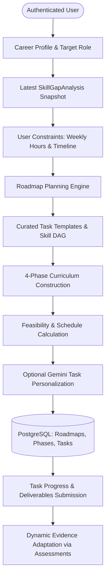
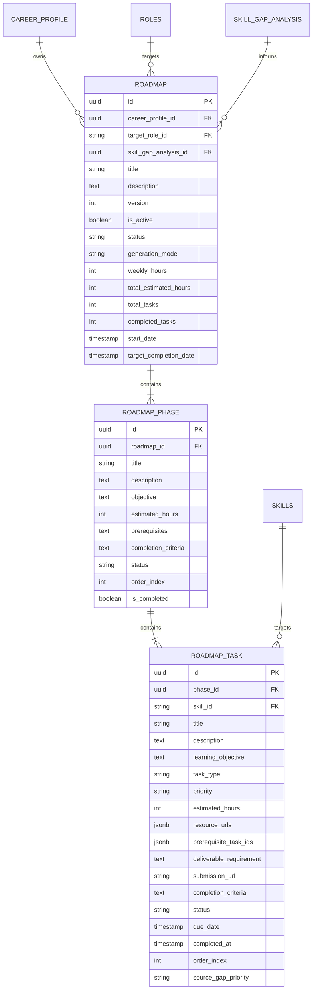

# CoachPath — Personalized Learning Roadmap Engine Architecture (Phase 7A)

## 1. Executive Summary

Phase 7A implements the backend **Personalized Learning Roadmap Engine** for CoachPath. Grounded in the user's actual career goals, verified diagnostic skill assessment results, latest skill gap analysis, and realistic study time constraints, this engine deterministically constructs a multi-phase, milestone-based learning curriculum.

### Core Architectural Invariants
1. **Evidence-Grounded**: Curriculums are generated directly from the candidate's latest `SkillGapAnalysis` snapshot. Skills already mastered or verified at target benchmark levels do not generate duplicate foundational tasks.
2. **Deterministic Milestone Progression**: Curated milestone task templates, prerequisites, duration estimates, deliverables, and completion criteria are defined deterministically. The application never relies on an LLM to hallucinate tasks, schedules, or dependencies.
3. **Topological Dependency Soundness (DAG)**: All prerequisite dependencies are strictly resolved within the generated roadmap and validated as an acyclic directed graph (DAG).
4. **Feasibility & Time Validation**: The engine validates available weekly hours against target timeline deadlines, computing mathematically rigorous completion dates and classifying feasibility (`feasible`, `demanding`, `unrealistic`).
5. **Dynamic Evidence Adaptation**: When candidates pass objective diagnostic assessments or update their career evidence, roadmaps adapt automatically—marking verified competencies as completed and updating remaining study commitments.

---

## 2. Roadmap Generation Workflow

---

## 3. Curriculum Structure & Phase Hierarchy

Roadmaps are organized into four progressive sequential phases:

| Phase | Phase Title | Focus & Pedagogy | Typical Task Types |
| :---: | :--- | :--- | :--- |
| **Phase 1** | **Foundations & Core Prerequisites** | Closing fundamental language and database gaps; establishing version control and syntax idioms. | `practice`, `reading` |
| **Phase 2** | **Applied Frameworks & Deep Practice** | Constructing REST APIs, components, microservices, and practical framework implementations. | `project`, `practice` |
| **Phase 3** | **System Architecture & Production Engineering** | Distributed caching, containerization, Kubernetes, security defenses, and CI/CD pipelines. | `project` |
| **Phase 4** | **Capstone Deliverable & Diagnostic Verification** | Comprehensive production-grade portfolio repository and objective diagnostic skill assessment verification. | `project`, `assessment` |

---

## 4. Mathematical Scheduling & Feasibility Calculations

### 4.1 Estimated Completion Duration
Given total estimated hours across all tasks ($H_{\text{total}}$) and planned weekly hours ($h_{\text{weekly}}$):
$$\text{Duration (weeks)} = \left\lceil \frac{H_{\text{total}}}{\max(1, h_{\text{weekly}})} \right\rceil$$

### 4.2 Projected Target Completion Date
$$\text{Target Completion Date} = \text{Start Date} + (\text{Duration in weeks} \times 7\text{ days})$$

### 4.3 Feasibility Classification
Given user target timeline in months ($M_{\text{target}}$), available weeks are:
$$W_{\text{target}} = M_{\text{target}} \times 4.33$$

1. **`feasible`**: $\text{Duration (weeks)} \le W_{\text{target}}$  
   Curriculum fits comfortably within the target timeline.
2. **`demanding`**: $W_{\text{target}} < \text{Duration (weeks)} \le W_{\text{target}} \times 1.35$  
   Requires steady commitment. Recommended pace is calculated as $\lceil H_{\text{total}} / W_{\text{target}} \rceil$ hrs/week.
3. **`unrealistic`**: $\text{Duration (weeks)} > W_{\text{target}} \times 1.35$  
   Identifies an impossible pace and warns the candidate with explicit suggested hour increases or deadline extensions.

---

## 5. Domain Data Model

---

## 6. API Endpoints Contract

All endpoints are mounted under `/api/v1/roadmap` and require active user authentication.

| Method | Endpoint | Summary | Status |
| :--- | :--- | :--- | :---: |
| `POST` | `/api/v1/roadmap/generate` | Generates a new personalized roadmap based on latest skill-gap analysis. | `201 Created` |
| `GET` | `/api/v1/roadmap` | Retrieves the active roadmap for the authenticated user. | `200 OK` |
| `GET` | `/api/v1/roadmap/active` | Alias endpoint returning the active roadmap. | `200 OK` |
| `GET` | `/api/v1/roadmap/{id}` | Retrieves a roadmap by ID (enforces user ownership). | `200 OK` |
| `GET` | `/api/v1/roadmap/{id}/progress` | Granular metrics: progress %, completed/remaining hours, next tasks. | `200 OK` |
| `PATCH`| `/api/v1/roadmap/tasks/{id}` | Updates task status (`in_progress`, `completed`, `skipped`) or submission URL. | `200 OK` |
| `POST` | `/api/v1/roadmap/{id}/adapt` | Adapts roadmap to new diagnostic assessment scores. | `200 OK` |

---

## 7. Dynamic Evidence Adaptation

When a candidate completes a diagnostic assessment:
1. `POST /api/v1/roadmap/{id}/adapt` queries passing diagnostic attempts (`AssessmentAttempt.passed == True`).
2. Identifies matching `skill_id`s with verified proficiency.
3. Automatically completes matching `pending` roadmap milestones (`status = 'completed'`, `completed_at = now`).
4. Recomputes phase completion (`is_completed = True`) and roadmap completed task counts.
5. Updates remaining curriculum hours and returns an audit breakdown of adapted tasks.
