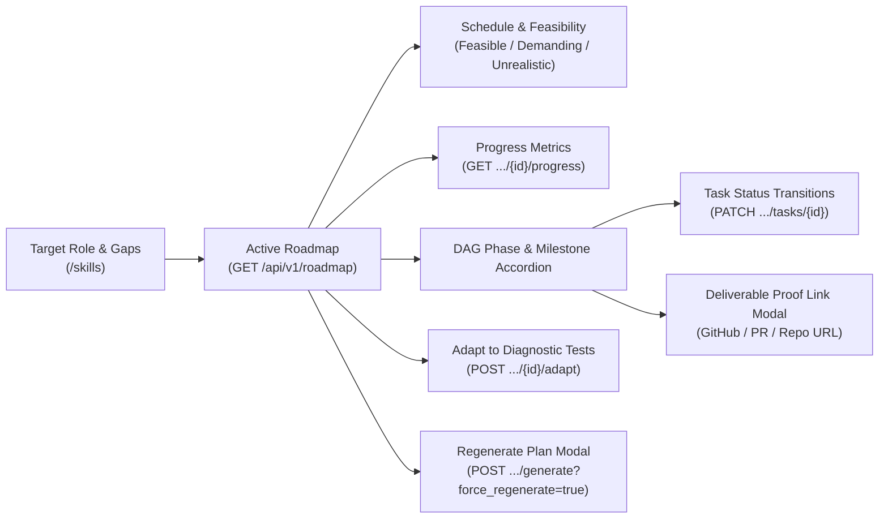
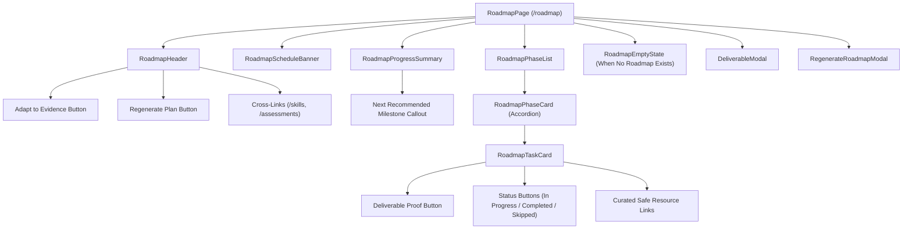

# CoachPath Personalized Learning Roadmap Frontend Architecture Specification

> **Document Version**: 1.0.0  
> **Lifecycle Phase**: Phase 7B — Personalized Learning Roadmap Frontend and Integration  
> **Status**: Completed & Verified  
> **Target Audience**: Frontend Engineering, Backend Engineering, AI/Data Engineering, Product, Design  

---

## 1. Executive Summary

Phase 7B delivers CoachPath's interactive **Personalized Learning Roadmap Frontend** (`/roadmap`), bridging the Phase 7A backend engine directly to candidates in an actionable, goal-oriented, and adaptive interface.

Rather than presenting an unverified, generic course list, CoachPath structures candidate study around a sequential curriculum derived mathematically from the candidate's **Skill Gap Analysis** against their selected target role.



### Core Architecture Invariants

1. **Zero Client-Side Task Generation**: The frontend never invents courses, phases, or milestone tasks. All curriculum structures, time allocations, and difficulty levels originate from the Phase 7A backend engine.
2. **Authoritative Progress Calculation**: Progress gauges, completed task counters, and remaining hour calculations reflect the transactional backend state. Optimistic UI updates are synchronized immediately with server responses.
3. **DAG Prerequisite Enforcement**: Milestone cards visually represent and enforce dependency ordering. If an earlier prerequisite milestone is still pending, dependent tasks are locked to prevent out-of-order execution.
4. **Deliverable-Driven Verification**: Tasks requiring project deliverables capture authentic proof (GitHub repository links, pull request URLs, or deployed demos) persisted in the backend database.
5. **Bidirectional Assessment Interactivity**: Real-time integration enables candidates to trigger roadmap adaptation (`POST /api/v1/roadmap/{id}/adapt`), auto-completing pending milestones when passing diagnostic assessments are recorded.
6. **Zero Mock Fallbacks**: Hardcoded mock roadmaps have been removed. Candidates without a roadmap are presented with an actionable setup state validating their target role and skill gaps before generation.

---

## 2. Information Architecture & Component Hierarchy

The roadmap dashboard is located at `frontend/src/app/(app)/roadmap/page.tsx` and is composed of high-cohesion modular components under `frontend/src/components/roadmap/`:



### Component Breakdown

| Component | File Path | Primary Responsibilities |
| :--- | :--- | :--- |
| **`RoadmapPage`** | `src/app/(app)/roadmap/page.tsx` | Page controller orchestrating data loading, empty states, task updates, adaptations, and modal triggers. |
| **`RoadmapHeader`** | `src/components/roadmap/RoadmapHeader.tsx` | Target role badge, version tag, active status, "Adapt to Evidence" action, "Regenerate" modal trigger, and links to `/skills` & `/assessments`. |
| **`RoadmapScheduleBanner`** | `src/components/roadmap/RoadmapScheduleBanner.tsx` | Feasibility badge (`feasible`, `demanding`, `unrealistic`), weekly hours commitment, total hours, target completion date, and educational guidance. |
| **`RoadmapProgressSummary`** | `src/components/roadmap/RoadmapProgressSummary.tsx` | High-contrast gradient summary card with completion percentage bar, hours completed/remaining, weeks remaining, and the next recommended actionable milestone. |
| **`RoadmapPhaseList`** | `src/components/roadmap/RoadmapPhaseList.tsx` | Container building an $O(1)$ lookup map for DAG dependency checking across all phases and rendering phase cards. |
| **`RoadmapPhaseCard`** | `src/components/roadmap/RoadmapPhaseCard.tsx` | Collapsible sequential phase accordion with phase completion progress bar and child milestone tasks. |
| **`RoadmapTaskCard`** | `src/components/roadmap/RoadmapTaskCard.tsx` | Interactive milestone card displaying priority, estimated hours, lock status, deliverable rubric, safe external resources, and status toggle buttons. |
| **`DeliverableModal`** | `src/components/roadmap/DeliverableModal.tsx` | Proof submission modal validating URL format (`http://` or `https://`) and submitting project links to the backend. |
| **`RegenerateRoadmapModal`** | `src/components/roadmap/RegenerateRoadmapModal.tsx` | Pace and deadline adjustment dialog allowing candidates to configure weekly study hours (1–60) and target timeline (1–36 months). |
| **`RoadmapEmptyState`** | `src/components/roadmap/RoadmapEmptyState.tsx` | Guided setup checklist validating target role and skill gap prerequisites, with interactive inputs to generate a candidate's first roadmap. |

---

## 3. Data Flow & API Client Layer

All API operations communicate with the Phase 7A backend via `frontend/src/lib/roadmap-client.ts` using the centralized `apiClient`:

```typescript
export class RoadmapClient {
  // GET /api/v1/roadmap?role_id=...
  public async getActiveRoadmap(roleId?: string): Promise<RoadmapData>;

  // GET /api/v1/roadmap/{id}
  public async getRoadmapById(roadmapId: string): Promise<RoadmapData>;

  // POST /api/v1/roadmap/generate
  public async generateRoadmap(payload?: RoadmapGenerateRequestPayload): Promise<RoadmapData>;

  // GET /api/v1/roadmap/{id}/progress
  public async getRoadmapProgress(roadmapId: string): Promise<RoadmapProgressData>;

  // PATCH /api/v1/roadmap/tasks/{id}
  public async updateTaskStatus(taskId: string, payload: UpdateRoadmapTaskPayload): Promise<RoadmapTaskItem>;

  // POST /api/v1/roadmap/{id}/adapt
  public async adaptRoadmap(roadmapId: string): Promise<RoadmapAdaptationData>;
}
```

### TypeScript Data Contracts (`src/types/index.ts`)

- **`RoadmapData`**: Authoritative roadmap entity including `target_role_id`, `version`, `weekly_hours`, `total_estimated_hours`, `feasibility_status`, and array of `phases`.
- **`RoadmapPhaseItem`**: Sequential phase entity including `title`, `description`, `order_index`, `status` (`pending`, `in_progress`, `completed`), and `tasks`.
- **`RoadmapTaskItem`**: Individual milestone task with `task_type`, `priority`, `estimated_hours`, `prerequisite_task_ids`, `deliverable_type`, `deliverable_rubric`, `submission_url`, `status`, and `resources`.
- **`RoadmapProgressData`**: Real-time progress metrics with `completed_hours`, `remaining_hours`, `estimated_weeks_remaining`, and `next_recommended_tasks`.
- **`RoadmapAdaptationData`**: Adaptation response detailing `tasks_auto_completed`, `tasks_adjusted`, `message`, and updated `roadmap`.

---

## 4. Prerequisite Handling & Cross-Service Navigation

### Prerequisite Validation
When navigating to `/roadmap`, if no active roadmap exists:
1. The client queries `skillGapClient.listRoles()` and `profileClient.getCareerGoals()` to identify the candidate's target role.
2. The client checks `skillGapClient.getLatestAnalysis()` to evaluate if a skill gap baseline has been calculated.
3. The `RoadmapEmptyState` component renders a 2-step verification checklist:
   - **Step 1: Designate Target Role** (linked to `/skills`).
   - **Step 2: Generate Skill Gap Analysis** (linked to `/skills`).
4. Once prerequisites are satisfied, the candidate configures their weekly hours (default 10h) and target completion timeline (default 6m) to generate Version 1.

### Bi-Directional Cross-Links
- **From `/skills`**:
  - Top action bar includes `Learning Roadmap` button.
  - Prioritized Remedial Gaps section features a callout card inviting candidates to bridge identified gaps in `/roadmap`.
- **From `/roadmap`**:
  - Header toolbar provides quick navigation to `Skill Gaps` (`/skills`) and `Take Assessment` (`/assessments`).

---

## 5. Security & Robustness

1. **Safe Outbound Resource Links**: External learning URLs are validated and rendered with `rel="noopener noreferrer" target="_blank"` to protect candidate sessions from reverse tabnabbing.
2. **URL Validation for Deliverables**: Project proof submissions must conform to valid URLs (`new URL()`), preventing script injection into deliverable fields.
3. **Graceful Error Recovery**: Network or validation failures trigger contextual toast/alert messages and offer one-click retry actions without resetting candidate input.
