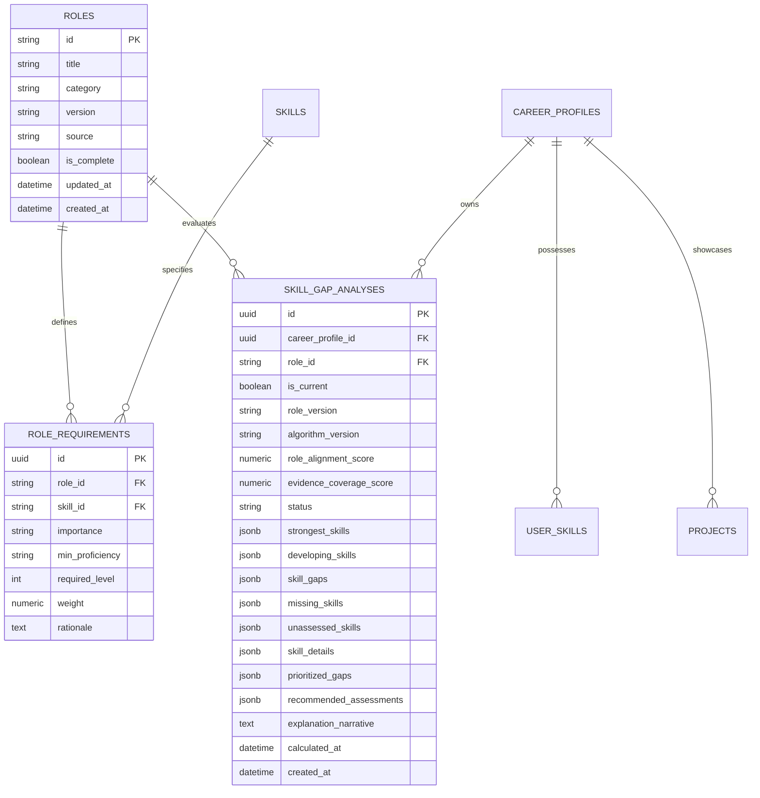

# CoachPath — Skill Gap Analysis Engine Architecture (Phase 6A)

## 1. Executive Summary

Phase 6A implements the backend **Skill Gap Analysis Engine** for CoachPath. The engine compares a candidate's verified career evidence against curated benchmark requirements of their selected target role to produce an explainable, deterministic diagnostic report.

### Key Architectural Invariants
1. **Deterministic & Explainable**: Core scoring, gap classification, and narrative generation execute without real-time LLM dependencies, guaranteeing repeatable, mathematical objectivity.
2. **Strict Verification Standards**: Claims originating solely from resumes or self-reporting are classified as unverified (`NOT_ASSESSED`) and cannot claim proficiency (Level 3) or mastery (Level 4). Mastery and proficiency require objective diagnostic assessment results or verified project artifacts.
3. **Multi-Source Evidence Calibration**: Incorporates objective Diagnostic Skill Assessments, calibrated `UserSkills`, verified projects, and approved resume claims into a unified evidence graph.
4. **Historical Snapshot Preservation**: All analyses are persisted as immutable point-in-time snapshots with an `is_current` active flag, preserving longitudinal skill progression over time.

---

## 2. Proficiency Scale & Evidence Calibration

Competency levels are normalized to a 4-tier numeric scale (0 to 4):

| Level | Tier Display Name | Competency Scope | Evidence Requirements |
| :---: | :--- | :--- | :--- |
| **0** | **Unobserved** | No evidence found in candidate record | Zero assessment, project, or profile claims |
| **1** | **Foundational / Basic** | Basic theoretical comprehension | Diagnostic test score < 50%, or basic claim |
| **2** | **Developing / Demonstrated** | Practical working knowledge | Diagnostic test score 50–69%, or verified project claim |
| **3** | **Proficient** | Production-ready independent execution | Passed diagnostic assessment (score 70–84%) |
| **4** | **Advanced / Mastered** | Deep architectural mastery & optimization | Passed diagnostic assessment (score ≥ 85%) |

### Competency Status Classification
Each role-required skill is categorized into one of five deterministic states:
- **`STRENGTH`**: Current level meets or exceeds required level ($\text{current} \ge \text{required}$).
- **`DEVELOPING`**: One level below required level ($\text{current} = \text{required} - 1$).
- **`GAP`**: Two or more levels below required level ($\text{current} < \text{required} - 1$).
- **`NOT_ASSESSED`**: Claimed in profile or resume but unverified by objective test.
- **`NOT_IN_PROFILE`**: Zero evidence in candidate profile or test records.

---

## 3. Mathematical Scoring Formulas

All calculations are deterministic, reproducible, and bounded between $0.0\%$ and $100.0\%$.

### 3.1 Per-Skill Coverage Ratio
$$\text{coverage\_ratio}_s = \min\left(\frac{\text{current\_level}_s}{\text{required\_level}_s}, 1.0\right)$$

### 3.2 Role Alignment Score ($0.0 - 100.0\%$)
Measures candidate benchmark readiness weighted by role requirement priorities:
$$\text{Role Alignment} = \frac{\sum_{s \in \text{Requirements}} (\text{coverage\_ratio}_s \times \text{weight}_s)}{\sum_{s \in \text{Requirements}} \text{weight}_s} \times 100$$

### 3.3 Evidence Coverage Score ($0.0 - 100.0\%$)
Measures the proportion of required role competencies supported by objective evidence:
$$\text{Evidence Coverage} = \frac{\sum_{s \in \text{Verified Evidence}} \text{weight}_s + 0.5 \sum_{s \in \text{Claimed Evidence}} \text{weight}_s}{\sum_{s \in \text{Requirements}} \text{weight}_s} \times 100$$

---

## 4. Canonical Skill Taxonomy & Target Roles

### 4.1 Canonical Taxonomy (`skills`)
- Master taxonomy of 48 standardized skills across 7 categories (`language`, `framework`, `database`, `tool`, `cloud`, `architecture`, `concept`).
- Normalized alias dictionary resolving 100+ common synonyms (e.g., `postgres` $\rightarrow$ `postgresql`, `js` $\rightarrow$ `javascript`, `k8s` $\rightarrow$ `kubernetes`).

### 4.2 Supported Target Roles (`roles`)
The engine seeds 7 canonical industry target roles with 65 curated role requirements:
1. **Backend Developer** (`backend-developer`): Python, SQL Databases, PostgreSQL, FastAPI, REST APIs, DSA, Redis, Docker, Git, Security, System Design.
2. **Frontend Developer** (`frontend-developer`): JavaScript, TypeScript, React, Next.js, HTML, CSS, Tailwind CSS, Web Development, REST APIs, Git.
3. **Full-Stack Developer** (`fullstack-developer`): JS/TS, React, Python, Web Development, SQL Databases, REST APIs, Docker, Git, DSA.
4. **Data Scientist** (`data-scientist`): Python, Machine Learning, SQL Databases, DSA, Deep Learning, PyTorch, Git.
5. **Machine Learning Engineer** (`machine-learning-engineer`): Python, Machine Learning, Deep Learning, PyTorch, Docker, REST APIs, DSA, SQL Databases, CI/CD.
6. **AI Engineer** (`ai-engineer`): AI & LLMs, Python, RAG, REST APIs, FastAPI, SQL Databases, Docker, Git, Security.
7. **DevOps & Cloud Engineer** (`devops-cloud-engineer`): Docker, Kubernetes, CI/CD, Linux, AWS, Terraform, Bash, Python, Git, Security.

---

## 5. Prioritization & Remedial Bridge

### 5.1 Gap Prioritization Algorithm
Identified skill gaps are ranked deterministically by:
1. **Requirement Importance**: `mandatory` ($0$) $>$ `preferred` ($1$) $>$ `bonus` ($2$).
2. **Deficit Size**: $(\text{required\_level} - \text{current\_level})$ descending.
3. **Requirement Weight**: Multiplier descending.

Priority labels assigned:
- **`CRITICAL`**: Mandatory requirement with $\text{deficit} \ge 2$.
- **`HIGH`**: Mandatory with $\text{deficit} = 1$ or Preferred with $\text{deficit} \ge 2$.
- **`MEDIUM`**: Preferred with $\text{deficit} = 1$.
- **`LOW`**: Bonus requirement.

### 5.2 Recommended Assessments Bridge
The engine matches unassessed skills and confirmed gaps directly to CoachPath's Diagnostic Skill Assessment question banks (Python, JS/TS, Java, C/C++, SQL & DBs, DSA, Web Dev, ML, AI/LLM), providing direct test links and estimated completion times.

---

## 6. Database Schema & Migration

### Alembic Migration: `d4e5f6a1b2c3_phase_6a_skill_gap_analysis.py`

---

## 7. API Specification

| Method | Endpoint | Description | Auth Required |
| :--- | :--- | :--- | :--- |
| `GET` | `/api/v1/roles` | List all supported canonical target roles | No |
| `GET` | `/api/v1/roles/{role_id}` | Get detailed role specification with requirements | No |
| `GET` | `/api/v1/roles/{role_id}/requirements` | Get requirement list for a specific role | No |
| `GET` | `/api/v1/skills` | List canonical technical skills taxonomy | No |
| `POST` | `/api/v1/skills/gap-analysis` | Calculate new gap analysis snapshot (optional `role_id`) | **Yes** |
| `GET` | `/api/v1/skills/gap-analysis` | Get latest active (`is_current=True`) gap analysis | **Yes** |
| `GET` | `/api/v1/skills/gap-analysis/history` | Get timeline history of gap analysis snapshots | **Yes** |
| `POST` | `/api/v1/skills/gap-analysis/recalculate` | Force recalculation with fresh assessment results | **Yes** |
| `GET` | `/api/v1/skills/gap-analysis/{skill_id}/evidence` | Granular drilldown of evidence supporting a skill | **Yes** |
| `GET` | `/api/v1/skills/gaps` | Legacy backward-compatible readiness summary | **Yes** |
