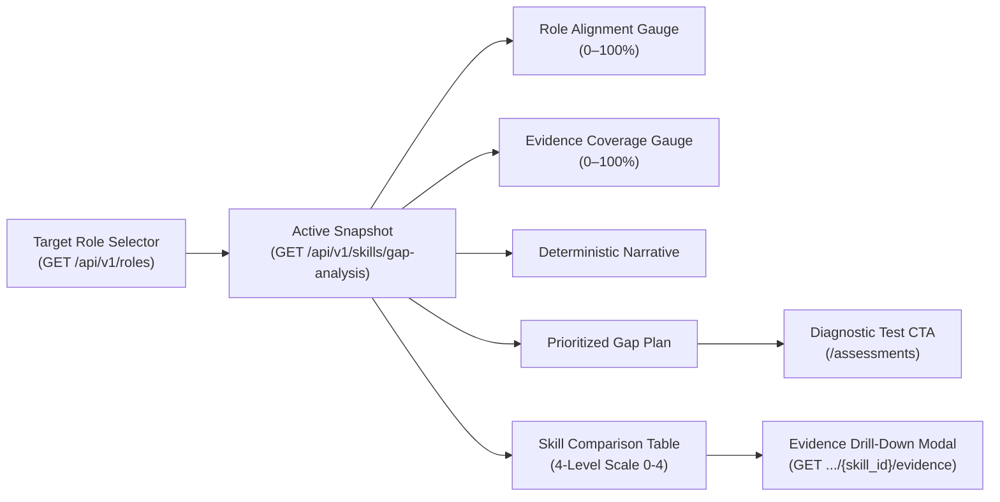
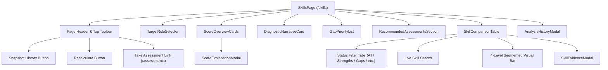
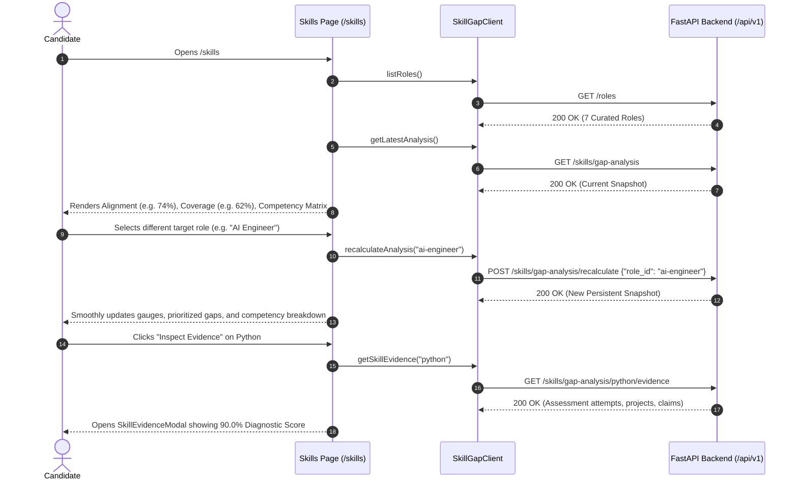

# CoachPath Skill Gap Analysis Frontend Architecture Specification

> **Document Version**: 1.0.0  
> **Lifecycle Phase**: Phase 6B — Skill Gap Analysis Dashboard & Frontend Integration  
> **Status**: Completed & Verified  
> **Target Audience**: Frontend Engineering, AI/Data Engineering, Product, Design  

---

## 1. Executive Summary

Phase 6B delivers CoachPath's interactive **Skill Gap Analysis Dashboard** (`/skills`), bridging the deterministic Phase 6A backend Skill Gap Engine directly to the user experience.

The dashboard transforms verified career credentials—objective diagnostic skill assessments, validated project repositories, and structured profile claims—into a transparent, mathematical diagnostic report against curated industry benchmarks.



### Core Architecture Invariants

1. **Zero Client-Side Calculation**: The frontend never invents, approximates, or recalculates role alignment or coverage scores. All mathematical evaluations originate deterministically from the FastAPI backend.
2. **Zero Mock Fallbacks**: Hardcoded sample data and synthetic mock states have been completely eradicated. Empty states cleanly guide candidates to complete onboarding or diagnostic tests.
3. **Strict Truthfulness & Provenance**: Claims residing solely in user profiles or unapproved resumes are strictly tagged as `NOT_ASSESSED` and visually barred from claiming Level 3 (Proficient) or Level 4 (Mastered).
4. **Transparent Explainability**: Every radial score is paired with an on-demand modal breaking down the mathematical formula, weights, and anti-hallucination rules in plain English.
5. **Bidirectional Assessment Interactivity**: Real-time integration allows candidates to navigate directly into Diagnostic Skill Assessments (`/assessments`) and jump back from assessment completion (`View Skill Gap Impact`) to recalculate scores immediately.

---

## 2. Information Architecture & Component Hierarchy

The dashboard is structured into high-cohesion, modular React components located in `frontend/src/components/skills/` orchestrated by `frontend/src/app/(app)/skills/page.tsx`:



### Component Directory & Responsibilities

| Component | File Location | Responsibility |
|---|---|---|
| `SkillsPage` | `src/app/(app)/skills/page.tsx` | Root coordinator; manages role selection, snapshot fetching, state transitions, and modal triggers. |
| `TargetRoleSelector` | `src/components/skills/TargetRoleSelector.tsx` | Dropdown role picker; identifies candidate's profile primary role with a dedicated badge; displays requirement counts and category pills. |
| `ScoreOverviewCards` | `src/components/skills/ScoreOverviewCards.tsx` | High-impact radial SVG gauges for Role Alignment ($0-100\%$) and Evidence Coverage ($0-100\%$), supported by quick-statistic status counters. |
| `ScoreExplanationModal` | `src/components/skills/ScoreExplanationModal.tsx` | Educational dialog explaining mathematical formulas, requirement weights, and CoachPath's strict anti-fabrication standards. |
| `DiagnosticNarrativeCard` | `src/components/skills/DiagnosticNarrativeCard.tsx` | Deterministic diagnostic paragraph generated by the backend summarizing strengths, core deficits, and recommended focus areas. |
| `GapPriorityList` | `src/components/skills/GapPriorityList.tsx` | Ranked priority cards (CRITICAL, HIGH, MEDIUM, LOW) distinguishing "ASSESS FIRST" (unverified claims) vs "LEARN & IMPROVE" (demonstrated deficits). |
| `RecommendedAssessmentsSection` | `src/components/skills/RecommendedAssessmentsSection.tsx` | Curated diagnostic tests mapped directly from the question bank to bridge identified gaps. |
| `SkillComparisonTable` | `src/components/skills/SkillComparisonTable.tsx` | Comprehensive tabular matrix comparing required vs supported levels across the 4-level scale, with live search and status filters. |
| `SkillEvidenceModal` | `src/components/skills/SkillEvidenceModal.tsx` | Granular multi-source evidence inspection modal detailing diagnostic test attempts, verified project repositories, and profile self-reports. |
| `AnalysisHistoryModal` | `src/components/skills/AnalysisHistoryModal.tsx` | Point-in-time longitudinal snapshot history preserving earlier analyses with active/archived indicators. |

---

## 3. Visual Specifications & Design Systems

### 3.1 4-Level Competency Visualization

The platform standardizes competency presentation using a 4-segment visual level bar:

| Level | Name | Description | Color Token | Segment Representation |
|:---:|:---|:---|:---|:---|
| **0** | **Unobserved** | No evidence in profile or assessments | `slate-200` / `slate-800` | `[ ][ ][ ][ ]` |
| **1** | **Foundational** | Conceptual understanding / Basic claim | `amber-400` | `[■][ ][ ][ ]` |
| **2** | **Developing** | Practical application / Test score 50–69% | `blue-400` | `[■][■][ ][ ]` |
| **3** | **Proficient** | Production execution / Test score 70–84% | `indigo-500` | `[■][■][■][ ]` |
| **4** | **Advanced** | Architectural mastery / Test score $\ge 85\%$ | `emerald-500` | `[■][■][■][■]` |

### 3.2 Status Classifications & Badges

- **`STRENGTH`** (Emerald): Current level meets or exceeds role requirement ($\text{Current} \ge \text{Required}$).
- **`DEVELOPING`** (Amber): Competency is exactly 1 level below benchmark ($\text{Current} = \text{Required} - 1$).
- **`GAP`** (Rose): Critical deficit of 2 or more levels below requirement ($\text{Current} < \text{Required} - 1$).
- **`NOT_ASSESSED`** (Purple): Skill is present in candidate profile or resume but lacks objective test calibration.
- **`NOT_IN_PROFILE`** (Slate): Role requirement with zero matching evidence across the candidate's account.

---

## 4. API Client & Data Flow

The frontend interfaces with the backend through a typed API client in `frontend/src/lib/skill-gap-client.ts`:

```typescript
export class SkillGapClient {
  public async listRoles(): Promise<TargetRolesListResponse>;
  public async getRole(roleId: string): Promise<TargetRoleDetail>;
  public async getRoleRequirements(roleId: string): Promise<RoleRequirementItem[]>;
  public async listCanonicalSkills(): Promise<CanonicalSkillItem[]>;
  public async getLatestAnalysis(): Promise<SkillGapAnalysisData>;
  public async calculateAnalysis(roleId?: string): Promise<SkillGapAnalysisData>;
  public async recalculateAnalysis(roleId?: string): Promise<SkillGapAnalysisData>;
  public async getAnalysisHistory(): Promise<SkillGapHistoryResponse>;
  public async getSkillEvidence(skillId: string): Promise<SkillEvidenceDetailResponse>;
}
```

### Data Synchronization Flow



---

## 5. Navigation & Cross-Module Integration

### 5.1 Sidebar Link
The main navigation sidebar (`frontend/src/components/layout/sidebar.tsx`) has been updated from generic "Skills" to:
- **Label**: `Skill Gap Analysis`
- **Route**: `/skills`
- **Icon**: `Target`

### 5.2 Diagnostic Assessment Result CTA
Upon completing an assessment attempt (`frontend/src/components/assessments/assessment-result-view.tsx`), candidates are presented with a primary action:
- **Button**: `View Skill Gap Impact`
- **Link**: Navigates directly to `/skills` where the new score is automatically integrated into their role benchmark.

---

## 6. Verification and Contract Testing

Phase 6B guarantees complete frontend-backend contract harmony:
- **TypeScript Compilation**: `npx tsc --noEmit` $\rightarrow$ 0 errors.
- **Production Build**: `npm run build` $\rightarrow$ 25 static pages generated successfully (`/skills` bundle size: 16.3 kB).
- **Automated Integration Tests**: `backend/tests/test_phase6b_frontend_integration.py` verifies:
  1. Role catalog discovery and role requirements retrieval.
  2. Snapshot retrieval matching `SkillGapAnalysisData` interface.
  3. Live assessment scoring impact on recalculated role alignment.
  4. Multi-source evidence drilldown payload validation.
  5. Error state contracts (401 unauthenticated, 404 non-existent role/skill).
- **Backend Test Suite**: Full suite of 143 tests passing in 20.31s.
